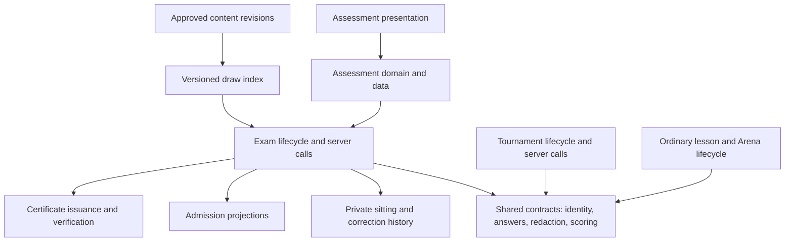

# Architecture Spine — Theme tests, final exam and certificate

This reconciliation preserves AD-1 through AD-37 and the owner's September 29–October 1 decisions. [EXAM-TECH-1](assessment-technical-contracts.md) C1, C2 arithmetic, C3 and C4 are adopted target contracts with [fixture oracles](assessment-contract-fixtures.json). C2 economics preserves original settled awards as confirmed by the owner; Q-EX-5 retains activation prerequisites. Adoption is not implementation, runtime acceptance or whole-MVP agreement. The current initiative spine and PRD govern the rest of the MVP.

Competition terminology follows [initiative AD-17](../architecture-schoolquiz3.0-2026-09-29/ARCHITECTURE-SPINE.md): **турнир** is the first qualification part; **чемпионат** is the second final part, including its bracket and matches. Existing `tournament*`/`event` identifiers retain their technical meaning for the competition lifecycle; this naming update does not change assessment contracts.

## Design Paradigm

Inherited layered Clean Architecture: pure Kotlin domain, data adapters, Decompose components, Compose rendering and callbacks. Ordinary lessons and Arena retain their offline lifecycle; EASY can score locally, while HARD results wait for server processing. Theme tests and the final exam use an online server-owned lifecycle. Tournaments retain their separate server-owned lifecycle; reconciling their fixed global cutoff with the shared online next-question window remains an initiative integration blocker.

Shared contracts cover answer representation, redaction, scoring arithmetic, operation identity and the adopted online next-question recovery window (initiative AD-31). They do not merge lifecycle state machines or terminal ownership. Mode-specific answer allowances and initial delivery remain separate.

## Invariants & Rules

### AD-1 — Share basic contracts; keep lifecycle ownership separate `[ADOPTED]`

- **Binds:** CAP-2, CAP-3, CAP-4, CAP-5, CAP-6, CAP-10
- **Prevents:** importing exam policy into tournaments or rebuilding the working tournament runtime to host exams.
- **Rule:** exam and tournament lifecycle, timing and termination belong to their respective domains. Shared core contracts contain no feature types or common lifecycle policy. Reuse scoring, answer/redaction and idempotency conventions through narrow adapters. No mandatory shared online-session state machine.

### AD-2 — The client never reads private session documents `[ADOPTED]`

- **Binds:** CAP-2, CAP-5
- **Prevents:** leaking private answer keys through a permissive document rule.
- **Rule:** exam session traffic uses authenticated server calls with ownership checks and explicit public projections. Private sessions, keys and draw indices have no client-readable path.

### AD-3 — A question deadline starts at its first acknowledgement `[ADOPTED]`

- **Binds:** CAP-4
- **Prevents:** network latency consuming answer time or retries restarting the clock.
- **Rule:** the server delivers image before question text; the first acknowledgement that the text rendered fixes its deadline. Later acknowledgements return that deadline unchanged. The first-question waiting-for-acknowledgement interval retains its existing bound; subsequent questions use the 60-second connection/download window in AD-30. Expiry of the original answer deadline automatically closes the current question as unanswered and advances toward the next question; reconnect cannot reopen it or extend that deadline. A timely accepted answer remains committed under AD-31. Every ThemeTest and FinalExam question uses the ordinary HARD answer-time rule, including the five EASY theme positions: seconds=max(5,roundHalfUp(chars*0.24)), with the ordinary character-count convention and image equivalent100. Do not multiply by examFactor0.75. Difficulty labels, scoring and 5-EASY/15-HARD composition remain unchanged; capture the timer rule with the sitting.

### AD-4 — A broken sitting scores its remainder as unanswered `[ADOPTED]`

- **Binds:** CAP-4, CAP-10, CAP-12
- **Prevents:** abandoning a losing sitting to avoid recording it.
- **Rule:** an expired acknowledgement gap or early finish closes the sitting through AD-30. Expiry of one answer deadline closes that question as unanswered and, while questions remain, starts the next-question window; it is not by itself expiry of that window or early finish. Unanswered scored positions receive the normal lowest score digit (digit1), never a paid correct skip or correct-answer progress. Closing the final question requests normal terminalization without an unnecessary 60-second wait. The sitting remains recorded and consumes its cooldown; reconnect cannot restart it.

### AD-5 — Ordinary scoring follows answer availability `[ADOPTED]`

- **Binds:** CAP-5, CAP-6, ordinary lesson play
- **Prevents:** client scoring without a key or treating a redacted HARD result as zero.
- **Rule:** ordinary EASY questions may carry keys and score locally; HARD keys never publish to the device. Ordinary HARD answers upload for server scoring, with a pending result until confirmation. Redacted payloads use their own types, not nullable correctness inside ordinary QuestionContent. This does not change ordinary offline, pause or recovery behavior. All assessment questions follow AD-21.

### AD-6 — Public results expose aggregates and safe advice `[ADOPTED]`

- **Binds:** CAP-5, CAP-6, CAP-16
- **Prevents:** retries becoming a per-question answer search.
- **Rule:** return aggregate percent, stars, pass/fail and safe lesson-level advice; never correct answers, per-item verdicts or codeAnswer. Private persisted score digits remain server-only. Advice also follows AD-33.

### AD-7 — Scoring arithmetic has one implementation per platform `[ADOPTED]`

- **Binds:** all scoring
- **Prevents:** different callers disagreeing on digits, percent or rounding.
- **Rule:** shared/core/scoring owns Kotlin arithmetic and its value types. The server uses the existing assessment-scoring.js arithmetic through adapters, not independent formulas in each mode. Kotlin/JS arithmetic changes together and uses shared fixtures. Timer/economy mirrors follow their own current contract.

### AD-8 — Admission is one transactional projection per user and theme `[ADOPTED]`

- **Binds:** CAP-1, CAP-7, CAP-9, CAP-16, CAP-17
- **Prevents:** a result without its admission update and separate best EASY/HARD interpretations.
- **Rule:** one record under users/{uid}, keyed by theme, holds one best mixed-sitting percent and passed state. The terminal scoring transaction writes the result and admission together. Ordinary writes improve monotonically; only the versioned correction path in AD-24 may lower it.

### AD-9 — Final admission compares theme identities for a course version `[ADOPTED]`

- **Binds:** CAP-1, CAP-9, CAP-16
- **Prevents:** matching counts admitting a player who passed the wrong themes.
- **Rule:** compare the passed theme-id set with required theme ids for the authoritative course version, using AD-26. Use the latest approved course version for each new start; passed stable theme identities carry according to AD-25. Clients cannot select an older course version.

### AD-10 — Eligibility counts distinct approved questions `[ADOPTED]`

- **Binds:** CAP-8, CAP-19
- **Prevents:** repeated publication inflating bank size.
- **Rule:** publication maintains versioned sets of question identities with the approved revision binding, split by theme/course and EASY/HARD. Count each question once, excluding quarantined revisions from current available counts. Certification minimum remains twelve theme tests, each with at least 100 EASY and 100 HARD questions.

### AD-11 — Submission validation does not enforce whole-course thresholds `[ADOPTED]`

- **Binds:** CAP-19, PRD FR-6
- **Prevents:** rejecting the first submission or holding approved questions behind failed siblings.
- **Rule:** apply submission-level schema rules separately from accumulated bank eligibility. Independently approved questions can publish through a valid new version; failed questions return for correction without blocking approved siblings.

### AD-12 — Author edits cannot remove established certification eligibility `[ADOPTED]`

- **Binds:** CAP-8, CAP-19
- **Prevents:** an author voluntarily dropping a certifiable course below its required bank.
- **Rule:** refuse author publication that would breach existing certification minimums. This does not prohibit curator quarantine of confirmed errors. If quarantine reduces current availability below certification requirements, new final exams are blocked until the bank is repaired; theme tests retain their separate AD-35 draw gate. Historical records never substitute for available questions.

### AD-13 — Publication owns the versioned draw index `[ADOPTED]`

- **Binds:** CAP-3, CAP-16
- **Prevents:** per-start course fan-out and accidental selection of an unapproved revision.
- **Rule:** publication builds the server-only theme/course draw index split by difficulty, binding immutable approved revisions and their private keys. There is no mandatory pretest pool. A new revision replaces the old one for new draws only after its own required approval.

### AD-14 — Each sitting uses a uniform draw with fixed composition `[ADOPTED]`

- **Binds:** CAP-3, CAP-16
- **Prevents:** incompatible draw sizes or hidden adaptive policies.
- **Rule:** uniformly select twenty distinct eligible questions within the assessed hierarchy and applicable course version. A theme test mixes five EASY and fifteen HARD; a final exam contains twenty HARD. No within-sitting easy gate, ranking, exposure weighting or history filtering. Two random sittings may coincidentally repeat a set.

### AD-15 — Approval of a revision admits it to the exam bank `[ADOPTED]`

- **Binds:** CAP-3, CAP-6, CAP-14, CAP-19
- **Prevents:** a cold-start deadlock and a second statistical prerequisite after content approval.
- **Rule:** every question revision, initial or subsequent, becomes exam-eligible after all required independent checks and approval. Mandatory hidden unscored items and accumulated statistics as a prerequisite are removed from the current MVP. Existing roles, independence and version-specific review remain binding.

### AD-16 — Quality signals lead to review; confirmed faults lead to correction `[ADOPTED]`

- **Binds:** CAP-14, CAP-21, PRD FR-6/7
- **Prevents:** an automated statistic being treated as proof of a wrong key.
- **Rule:** statistics and reports are review signals, not automatic removal or revocation. A confirmed error is quarantined by the authorized content process, with a reason and revision identity. Preserve already issued/started banks and process affected results through AD-24. Review covers affected dependent content and translations.

### AD-17 — Preserve original sittings and versioned corrections `[ADOPTED]`

- **Binds:** CAP-14, CAP-21
- **Prevents:** losing reconstruction evidence after content edits.
- **Rule:** persist sittings separately from ordinary result_events, with player, exam, immutable selected revisions/keys, rule snapshot, answers, timings and original outcome. Corrections append attributable result versions; they do not replace the original evidence. Clients cannot write this store.

### AD-18 — Starts and purchases settle on the server `[ADOPTED]`

- **Binds:** CAP-11, CAP-12, CAP-13
- **Prevents:** duplicate charges and local deductions erased by profile refresh.
- **Rule:** successful theme-test start costs 1 full STANDARD charge (100 points); successful final-exam start costs 2 full STANDARD charges (200 points), from server configuration. STANDARD-only entry is inherited from spec-charges CAP-1 and its round-1 decision: plasma never pays the toll and there is no pool split to choose. Reconcile legacy final300 configuration before enabling real debit; that value is implementation drift, and reward basis C1 remains independent of the debit pool. Session creation and charge are atomic and idempotent; refused starts cost nothing. Cooldown is rolling 24 hours for ThemeTest per user/theme and rolling 168 hours (7 days) for FinalExam per user/course, from terminal closure including timeout or abandonment. Recovery of the same open sitting creates neither another charge nor a new cooldown anchor. Ordinary lesson unlocks preserve their accepted offline local half: unlock + provisional nolics debit + outbox in one Room transaction, same operation on retry and visible rollback on quarantine; the server confirms the financial fact. The prohibition on device-side exam charging does not prohibit that path. Do not restore obsolete flat unlock prices or standalone local debits.

### AD-19 — Certificates remain immutable; the latest earned issuance is displayed `[ADOPTED]`

- **Binds:** CAP-8, CAP-18
- **Prevents:** corrections mutating earned claims, best-score display hiding a later pass, and delayed signing replacing a newer certificate.
- **Rule:** only a successful final-exam terminal result authorizes issuance; failure creates no certificate and does not replace the current one. A new final sitting is allowed before or after expiry under the existing admission, charge and cooldown rules. Each new successful sitting creates a distinct immutable certificate with its own one-year term from that earning outcome; earlier certificates remain in history without changed identity, claims or dates. Default display selects the latest by authoritative server earning chronology even when its passing score is lower, never the highest score or signing-completion order. Exam owns issuance/signing/verification; profile consumes its read-only projection/UI. For every successful final, terminal success, its immutable logical issuance fact and durable signing/publication work commit atomically. Bind issuanceId, sitting, earning resultVersion, percent/pass mark, bank snapshot, frozen public claims, issuedAt/expiresAt, key identity and server-owned total earning order at that boundary. Signing/publication fulfill this fact outside the transaction with explicit pending state; replay keeps the same issuance identity, eligibility and dates. Delayed fulfillment of an older issuance cannot replace the newer projection; a rollback commits neither success nor issuance. Public attestation never joins mutable profile/course fields. A later downward correction caused by our question error preserves each issued certificate exactly, including original expiry and validity on this ground; record correction separately without extending the term. Retain verification material for earlier signatures across rotation; no new crypto provider/algorithm is selected. Theme best-result/admission policy and separate administrative revocation grounds are unchanged. A correction that changes a formerly failed final to passing does not authorize a new certificate for that sitting; only a new successful final sitting can earn one. Issuance already earned at original successful terminal closure, including pending signing, remains unchanged.

### AD-20 — Provisioning remains outside exam lifecycle `[ADOPTED]`

- **Binds:** ordinary lessons and Arena
- **Prevents:** offline ticket, quota or purchase policy entering exam timing.
- **Rule:** existing Arena and ordinary content provisioning remain separate from assessment. Their current PRD authorization, reserve, offline and recovery rules apply. Old Arena quota/price seeds in this run do not override the later PRD.

### AD-21 — Every assessment answer is server-scored `[ADOPTED]`

- **Binds:** CAP-2, CAP-5, CAP-6, CAP-9
- **Prevents:** client-generated EASY scores clearing final admission.
- **Rule:** both difficulties in a theme test and every final-exam question are scored on the server. The client sends bound answers, never authoritative score digits, stars or percent. Assessment presentation invokes no scoring function.

### AD-22 — All twenty served questions are scored `[ADOPTED]`

- **Binds:** CAP-14, CAP-16
- **Prevents:** an extra hidden denominator or obsolete pretest score positions.
- **Rule:** each newly started sitting has exactly twenty scored questions and no mandatory unscored additions. Confirmed post-sitting corrections use explicit versioned correction rules under AD-24, not pretest markers.

### AD-23 — Quarantine preserves history, not availability `[ADOPTED]`

- **Binds:** CAP-8, CAP-14, CAP-19
- **Prevents:** counting quarantined items to manufacture a usable bank.
- **Rule:** retain quarantined revisions for audit and frozen issued banks; remove them from new eligible draws and current available counts. Show existence/history separately from currently approved availability. Apply AD-35 to new starts; do not infer certification eligibility from historical counts.

### AD-24 — Corrections reproduce original evidence without rewriting certificates `[ADOPTED]`

- **Binds:** CAP-14, CAP-17, CAP-18, CAP-21
- **Prevents:** order-dependent arithmetic, invalid evidence preserving admission, duplicate effects and retrospective certificate creation.
- **Rule:** authorized confirmed-fault exclusions follow EXAM-TECH-1 C2: map cumulative exclusions to distinct original slots and reproduce retained digits from frozen evidence/scoringVersion. For retained N>0, percent=floor(sum(floor(100*(digit_i-1)/8))/N); unanswered positions remain digit1, excluded positions leave both sum and denominator. Use captured pass mark and AD-37 star mapping; never infer denominator from submitted answers. Append attributable correction version, immutable evidence digest and idempotent correctionId/body, then CAS head. Commit that head and recomputed theme admission/best atomically, or atomically advance its durable correction generation/pending barrier. Materialization must match current result/correction version and generation; obsolete work cannot overwrite a newer projection. New final start verifies current/applied correction generation and readiness in its start/charge transaction, refusing pending/unavailable before spending; queued work cannot authorize through stale passed state. Recompute from usable latest results across sittings; an independent valid pass still suffices and already started sittings stay frozen. UNSCORABLE_ALL_EXCLUDED and CORRECTION_PENDING_EVIDENCE have no score/pass/stars and cannot use a known-invalid old result as current admission proof. No invented compensation or cooldown reset. Original evidence and AD-19 certificate entitlement remain unchanged, including signing pending; correcting a failed final to pass issues no certificate. A first-ever theme pass may pay once if no award receipt exists, using original frozen basis and b0 atomically with admission. Preserve every already settled nolics/XP receipt and reward-accounted maximum exactly: correction performs no top-up, recoupment, reset or advance from corrected score. The shared theme aggregate generation covers every input-changing result write, including a newly terminal theme sitting while a correction is pending. All terminal/correction writers advance or transactionally coordinate that same generation. A materializer must validate the full input generation before publishing, so a stale correction result cannot overwrite a newer valid theme pass; retry recomputation against the new generation instead.

### AD-25 — New starts use the current course; stable theme passes carry `[ADOPTED]`

- **Binds:** CAP-1, CAP-9, CAP-16
- **Prevents:** clients pinning obsolete admission rules or edits changing an active sitting.
- **Rule:** publication owns authoritative courseVersion for structure and question changes. Each new start uses the latest approved version; issued sittings retain their frozen inputs. A passed record carries by stable (courseId, themeId) when that theme's question content changes. Only newly added required themes need another pass; extra archived ids are ignored. This carry does not prevent AD-24 from correcting a result whose evidence was actually erroneous.

### AD-26 — Admission requires a subset over non-archived themes `[ADOPTED]`

- **Binds:** CAP-1, CAP-9
- **Prevents:** an extra historical passed theme disqualifying its owner.
- **Rule:** every required non-archived theme id at the applicable course version must occur in the passed set. Extra ids are ignored.

### AD-27 — Exam admission requires confirmed manifest-bound EASY coverage `[ADOPTED]`

- **Binds:** CAP-1, CAP-11
- **Prevents:** star/count/forged-digit admission, lost revision provenance and charging before confirmed full coverage.
- **Rule:** learning ingestion owns EXAM-TECH-1 C3: publication supplies immutable required-EASY canonical question/revision manifest; ordinary attempt/outbox evidence freezes its reference, answer, timing and permitted-help provenance without adding an offline ticket. Validate owner, revision/membership and full-credit answer against approved immutable content. Union successful exact tokens across attempts; requiredTokens must be a subset of confirmedSuccessfulTokens at the current manifest. Repeated tokens count once, counts/stars and a twenty-question subset do not prove coverage. New/revised required tokens need proof, unchanged exact tokens carry; already-passed stable themes still follow AD-25/26. Evidence, receipt and projection commit atomically or expose a durable pending materialization barrier. New start atomically rechecks current manifest and confirmed generation before charge: incomplete Locked, relevant undelivered/unmaterialized progress ResultsNotSynced, missing authority Unavailable. Empty/legacy unknown is not silently complete; upload ACK alone is insufficient. Ordinary offline progression stays immediate and ingestion never repays rewards.

### AD-28 — Final results and cooldowns have their own identity `[ADOPTED]`

- **Binds:** CAP-8, CAP-12, CAP-16, CAP-18
- **Prevents:** using a course id as a theme id or inventing separate exam rungs.
- **Rule:** theme and final are each one sitting type. Final results are keyed by user/course in a collection distinct from theme admission. Canonical cooldown keys are theme:{themeId} for rolling 24 hours and final:{courseId} for rolling 168 hours, scoped to the user with no difficulty segment; terminal closure is the anchor.

### AD-29 — One open sitting per exam is recoverable without a second charge `[ADOPTED]`

- **Binds:** CAP-2, CAP-10, CAP-12, CAP-13
- **Prevents:** lost start responses burning another charge or restarting deadlines.
- **Rule:** at most one open sitting per user/exam. Starting against an existing open sitting recovers it; original operation identity remains bound. Only terminal closure, including timeout or abandonment, opens the mode-specific cooldown window; recovery never restarts this anchor or creates another debit. Recovery returns the current authoritative question/deadline; it does not pause or extend it.

### AD-30 — One fenced exam worker owns terminalization and durable recovery `[ADOPTED]`

- **Binds:** CAP-4, CAP-10, CAP-21
- **Prevents:** competing terminal writers, abandoned sittings stuck open, cursor starvation and stale worker publication.
- **Rule:** the exam sweeper is the sole logical compare-and-set terminal writer; foreground only advances, reads or requests finish. EXAM-TECH-1 C4 fixes injected trusted clock/store, bounded durable sweep with wrap, mutation fencing, retry/overlap/crash convergence and non-starving actionable poison work. Isolated test/demo calls the same capability; production uses the existing Firebase Functions v2 onSchedule wake-up adapter, not an exactly-once promise. Clients choose no worker clock/cursor/lease, and scheduler delay never extends deadlines. The first acknowledgement gap begins at sitting creation and retains its existing bound without a new duration choice. Each subsequent connection/download gap uses the shared server-owned configuration of initiative AD-31, default60 seconds, captured in the sitting rule snapshot; no exam-specific hardcoded value or later config change resets the window. Its anchor is authoritative closure of the preceding question: its timely accepted answer or its original answer-deadline expiry. Reconnect, retries and delayed sweeps preserve that anchor. No gap truncates or extends an active answer allowance; question expiry advances as unanswered, while gap expiry requests terminalization under AD-4. After the final question closes, terminalization proceeds without another delivery gap. Still-open result reads return typed open state. Signing claims fenced durable work, signs/verifies exact frozen claims/key outside TX, and CAS-publishes against issuance identity/digest/fence; first verified artifact wins. Rotation preserves pending-bound signing and historic verification material; missing keys remain recoverable pending. Concrete provider/algorithm/environment/cadence/runbook proof stays Q-EX-5 before activation. Tournament settlement retains its own policy.

### AD-31 — Answer commitment is idempotent per question `[ADOPTED]`

- **Binds:** CAP-4, CAP-5
- **Prevents:** retries replacing accepted answers with timeout or different answers.
- **Rule:** the first committed answer for sittingId/questionIndex wins. Bind owner, question revision and payload identity; identical retry returns its receipt and conflicting reuse cannot overwrite it or advance the next question. Preserve server receipt time across recoverable server processing failures.

### AD-32 — Ordering uses a single canonical answer frame `[ADOPTED]`

- **Binds:** CAP-5, CAP-14
- **Prevents:** applying shuffle reversal twice during scoring or rescore.
- **Rule:** wire answers use issued item identities. Map to canonical identities exactly once at the boundary, retaining the issued permutation and canonical answer in private evidence. Redaction includes shuffling where order itself exposes correctness.

### AD-33 — Advice must not identify one failed item `[ADOPTED]`

- **Binds:** CAP-6
- **Prevents:** a one-item lesson name exposing that item's verdict.
- **Rule:** use a fixed-length advice list at every score, including perfect scores; do not name lessons contributing fewer than the configured support threshold. When the sitting cannot support safe advice, use the admission history rather than a single-item inference.

### AD-34 — Cooldown projections cover both assessment kinds `[ADOPTED]`

- **Binds:** CAP-11, CAP-13, CAP-20
- **Prevents:** final-exam cooldowns disappearing from the overview.
- **Rule:** expose server-written user-scoped cooldown projections for theme tests on their admission records and final exams on their distinct course-result records. No private session read is needed. Confirmed lesson unlocks remain server-owned economy records; their provisional ordinary offline projection and pending debit follow AD-18, never standing in for server-confirmed EASY admission.

### AD-35 — Insufficient available pools refuse before spending `[ADOPTED]`

- **Binds:** CAP-3, CAP-12, CAP-13
- **Prevents:** silently shorter exams or paying for a failed draw.
- **Rule:** a theme test requires at least five approved available EASY and fifteen HARD revisions; a final requires twenty HARD, independently of the larger certification thresholds. PoolTooSmall refuses before session/charge commitment. Publication exposes versioned available counts for the UI; the server rechecks at start.

### AD-36 — Assessment rewards freeze ordinary worth and marginal accounting `[ADOPTED]`

- **Binds:** CAP-13, CAP-15, CAP-16
- **Prevents:** answer-timer or random-draw repricing, mixed-base/rounding drift and repaying accounted progress.
- **Rule:** EXAM-TECH-1 C1 and its fixture oracle define the exact reward contract. Publication chooses one canonical ordinary worth-source revision per eligible question, deduplicates translations, and freezes pool counts/time sums, basis manifest/hash and rewardRuleVersion at start; unknown basis refuses before charge. Ordinary EASY/HARD worth is independent of the all-HARD assessment answer timer. Theme TE=halfUp(5*sum(sE)/countE), TH=halfUp(15*sum(sH)/countH); final TE0, TH=halfUp(20*sum(sH)/countH); B=(TE+3TH)/720. Preserve cumulative marginal tariff W: P=c*max(W(p)-W(b),0)+r*W(min(p,b)), R=P*B; theme c3/r0 first-pass-only, final c10/r0.1 every terminal sitting. Compute XP=halfUp(R) and nolics=halfUp(R/10) independently from exact unrounded R using checked integer/rational arithmetic. No extra whole-reward multiplier, per-band currency rounding, elapsed-time substitution or later-content rebasing. Durable per-user/assessment b is independent of latest certificate/theme best and never resets on lower results or renewal. One transaction binds eligibility, receipt, wallet/XP effects and bNext=max(b,p), including rounded zero; retries return the same sitting effect. Failed unpaid themes leave b0; first corrected theme pass may use its frozen basis/b0 once if award absent. C2 preserves any already-settled nolics/XP receipt and accounted maximum exactly; corrected score creates no top-up, recoupment, reset or advance.

### AD-37 — Exam results render the authoritative percent and star projection `[ADOPTED]`

- **Binds:** CAP-6, CAP-7
- **Prevents:** mixed-sitting star scales diverging, display rounding changing admission, and client recomputation differing from the server.
- **Rule:** ThemeTest uses a linear 0–3-star scale from overall percent p: the server computes starsTenths=roundHalfUp(30*p/100), for p in [0,100], retaining tenths and half-up rounding. Examples: 60%=1.8, 95%=2.9, 100%=3.0. Pass/fail uses the original authoritative percent and applied pass mark, never rounded stars. Theme best-result policy is unchanged. Assessment presentation renders returned percent, stars, pass state and advice without recomputation or a scoring dependency.

## Consistency Conventions

| Concern | Rule |
| --- | --- |
| Assessment names | ThemeTest is контрольная; FinalExam is the course экзамен. |
| Calls | startThemeTest, startFinalExam, acknowledgeQuestion, submitAnswer, finishSitting, fetchSittingResult. A recovery/start returns current state; finish requests terminalization. |
| Identity | Persistent client operation/sitting identity is bound to owner and immutable request; server checks remain authoritative. |
| Redaction | Separate answer-free payload types; Survey is excluded. No key, future question or codeAnswer in client projections. |
| Refused start | Typed Locked, Cooldown, InsufficientCharge, ResultsNotSynced, PoolTooSmall, plus explicit unavailable server state; no obsolete LadderNotReached. |
| Rules snapshot | Server config owns pass mark (default 60%), mode-specific rolling cooldown (theme 24 hours, final 168 hours), the existing initial ACK bound, the adopted 60-second subsequent connection/download window, composition, prices and minimums. A sitting binds its applied rule version. |
| Auth scope | User flows switch on current uid; stale responses cannot update another account or session. |
| Content corrections | New revision needs its own required checks; unaffected checks retain valid provenance. Frozen issued banks do not mutate. |

## Structural Seed

Existing Kotlin scoring and server assessment-scoring, answer redaction and ordinary result processing are reused. Existing tournament session/controller/worker code owns tournament behavior. Assessment domain/data and its presentation add exam-specific lifecycle calls, immutable sitting storage, admission, draw and certificate orchestration. Core gains only missing neutral contracts justified by actual shared callers.

Technology versions are inherited from the active candidate's verified project/toolchain contract; the August version table is retired rather than treated as a new dependency choice.

## Capability → Architecture Map

| Capability | Governing decisions |
| --- | --- |
| CAP-1, CAP-9, CAP-11, CAP-17 | AD-8, AD-9, AD-18, AD-25, AD-26, AD-27 |
| CAP-2–6, CAP-10 | AD-1–7, AD-21, AD-29–33, AD-37 |
| CAP-7, CAP-15 | AD-8, AD-24, AD-36, AD-37 |
| CAP-8, CAP-16, CAP-18 | AD-9, AD-14, AD-19, AD-25, AD-28, AD-35 |
| CAP-12, CAP-13, CAP-20 | AD-18, AD-28–31, AD-34, AD-35 |
| CAP-14, CAP-19, CAP-21 | AD-10–17, AD-22–24 |

## Open Questions and Deferred

- **Exam debit implementation (UX-O1):** 100/200 STANDARD points are adopted; plasma and a pool split are not open product alternatives. Before real debit, reconcile legacy final300 configuration and prove the economic adapter against [spec-charges CAP-1](../../../specs/spec-charges/SPEC.md). C1–C4 remain unchanged.
- **Shared online-window integration:** initiative AD-31 owns the adopted 60-second next-question window. The existing tournament global cutoff can expire inside that window; resolve that conflict before enabling the affected shared adapter. This exam contract neither shortens the guaranteed window nor invents a match/stage extension.

- **Execution activation (Q-EX-5 remainder):** C4 worker/signing/recovery boundaries and controlled-driver/production wake-up adapters are adopted. Choose concrete signing provider/algorithm, secret bindings, environment allowlist, cadence/budgets/retention and prove the runbook before enabling the relevant environment; no service activation is authorized here.
- **Exposure control:** uniform draw remains; revisit only with measured exposure data.
- **Standalone verification:** server verification remains; revisit a self-contained verifier before availability requirements change.
- **Theme placement and course stars:** defer their separate product rules before building those optional surfaces.
