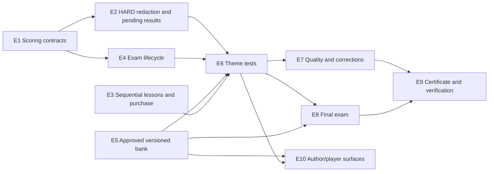

# Epic breakdown

Reconciled 2026-09-30 with [ARCHITECTURE-SPINE.md](ARCHITECTURE-SPINE.md). E1–E10 and AD/CAP identities remain stable. These are work boundaries, not claims of readiness or permission to deploy. Existing implementations must be inspected before a story treats an old seed as missing code. [EXAM-TECH-1](assessment-technical-contracts.md) C1/C2 arithmetic/C3/C4 and [arithmetic fixtures](assessment-contract-fixtures.json) are adopted contracts; C2 settled-award economics preserves original receipts/accounted progress, and concrete Q-EX-5 settings/evidence remain before activation.

## Dependencies

The E9 model/verification contract can be designed in parallel; actual issuance waits for the accepted final-exam and correction contracts.

## E1 — Ratify shared scoring contracts

**Governed by:** AD-7, AD-21, AD-37.

The Kotlin core scoring module and JavaScript assessment scorer already exist. Inspect current callers and shared fixtures; add only missing integration. No second per-mode arithmetic. Client assessment presentation consumes results without invoking scoring.

**Acceptance:** server/client shared arithmetic fixtures remain consistent; exam callers use the server scorer; ordinary behavior and tournament scoring contracts are preserved. This document records no new test result.

## E2 — HARD keys and deferred ordinary results

**Governed by:** AD-2, AD-5, AD-6, AD-32. **Depends on:** E1.

Reuse existing key storage/redaction and verify all required question types. HARD ordinary play remains offline-capable with an explicitly pending score until server confirmation. EASY local scoring remains available. Redacted types do not weaken ordinary QuestionContent invariants.

**Acceptance:** private keys and implicit Ordering answers do not reach client projections; ordinary HARD offline→sync yields a confirmed result without an invented local zero. Exam responses also exclude codeAnswer and per-item verdicts.

## E3 — Sequential lessons, progress and purchases

**Governed by:** AD-18, AD-20, AD-27, AD-34. **Serves:** CAP-1, CAP-9, CAP-11.

Reuse the existing course gate and ordinary unlock operation, including its offline unlock + provisional local nolics debit + outbox Room transaction, stable server confirmation and visible quarantine rollback. Implement C3 manifest-bound required-EASY coverage: freeze canonical question/revision and raw-answer provenance in existing ordinary attempts/outbox, validate server-side, union successful exact tokens across attempts and bind the confirmed projection to required-set hash/generation/receipts. Preserve ordinary offline progression and add no server ticket. Purchase opens access, never grants completion. No restoration of obsolete flat 10/20 tariffs.

**Acceptance:** local ordinary progression works offline; confirmed progress gates the exam; bought unplayed lessons remain unpassed; retries do not repeat purchase effects. Do not equate a rounded star floor or arbitrary twenty-question subset with full required coverage. Cover a required30-token lesson through20+10; repeated20, wrong revision, forged digit/help and ambiguous legacy evidence do not grant admission. Recheck current manifest and confirmed generation atomically before exam charge; upload ACK alone is insufficient.

## E4 — Exam-specific online lifecycle

**Governed by:** AD-1–4, AD-17, AD-21, AD-29–32. **Depends on:** E1.

Build missing exam lifecycle and adapters using narrow shared answer/redaction/scoring/identity contracts. Keep existing tournament lifecycle and continuous timing separate. Implement idempotent start/recovery, first-ack deadline, first-answer receipt, finish request and single exam-sweeper terminal writer.

**Acceptance:** lost responses recover the same session/charge; ack and answer retries never extend time or overwrite evidence; abandonment eventually produces one terminal result. First-question gap is bounded. No runtime is started by this planning artifact.

**Recovery contract:** apply C4 bounded sweep/wrap, CAS/fencing, non-starving poison handling and the same capability under isolated controlled driver or production existing v2 onSchedule wake-up. Verify overlap/crash/lost-fence/backlog recovery without changing deadlines or receipts. Concrete environment allowlist, cadence/budgets and runtime evidence remain prerequisites before activation.

## E5 — Approved versioned draw bank and eligibility

**Governed by:** AD-10–15, AD-22–23, AD-25, AD-35.

Publication records approved question revisions and immutable private-key bindings in a server-only index split by hierarchy and difficulty. C1 also binds one ordinary worth-source revision per canonical identity, canonical eligible pool counts/time sums and frozen reward basis/hash before spending; translations cannot inflate financial worth. Count distinct question identities. All required independent checks and approval establish eligibility; remove obsolete pretest stages.

Keep the course certification threshold separate from the per-sitting draw threshold. Refuse author edits that voluntarily break certification; curator quarantine can reduce current availability and block new final exams. Retain historical revisions for audit and frozen active banks, not as available count.

**Acceptance:** re-publication does not inflate counts; a new approved revision needs no statistical incubation; failed siblings do not block valid independently approved questions; too-small new draws refuse before charge.

## E6 — One mixed theme test and admission projection

**Governed by:** AD-8–9, AD-14, AD-18, AD-21–22, AD-26–29, AD-34–37. **Depends on:** E2, E3, E4, E5.

A theme test is one mixed 5-EASY/15-HARD sitting with default 60% pass mark, 100-unit charge and a rolling 24-hour per-user/theme cooldown from terminal closure, including timeout/abandonment. No difficulty rungs or phases. Terminal result and one best/passed projection commit together; first-pass reward identity is user/theme. Server ThemeTest stars use roundHalfUp(30*p/100) tenths on a linear 0–3 scale; pass/fail still uses percent. For both nolics and XP, NEW-progress coefficient3 replaces ordinary NEW2 while difficulty/allocated-time factors and weighted marginal bands remain separate.

Passed themes carry across content updates by stable course/theme identity; only new required themes need another test. A confirmed-fault rescore remains a separate exception to monotonic progress.

**Acceptance:** ordinary worse retakes do not lower best, retry does not duplicate reward, required new themes block final admission, changed question content alone does not reset a passed theme. Result contains only server aggregates and safe advice.

**Reward contract:** AD-36 retains first-pass-only payout and stable user/theme identity; earlier failed unpaid theme attempts leave reward-accounted progress at zero. Payout receipt/accounted progress commit atomically even if rounding yields zero. Implement adopted C1 capped5/15 ordinary-worth means, exact weighted marginal tariff and independent XP/nolics half-up rounding against its fixtures. A first-ever pass created by valid correction pays once only if the theme receipt is absent, from original frozen basis and b0; C2 keeps already-settled receipt/accounted progress unchanged without any adjustment. Star display is settled by AD-37 and does not determine reward rounding.

## E7 — Review signals and attributable corrections

**Governed by:** AD-15–17, AD-19, AD-22–24. **Depends on:** E6 for end-to-end sitting correction.

Required independent review belongs to the content publication flow. Statistics and complaints provide repeat-review signals, not automatic verdicts. Confirmed errors leave future draw pools; correction versions preserve original attempts and can recompute admission in either direction.

**Acceptance:** a signal alone does not remove content or revoke a certificate; confirmed correction retains original evidence, affects the intended revision's sittings and is replay-safe. Active banks stay frozen. Already issued certificate identity, signed score/claims, dates, expiry and validity remain unchanged when our question error lowers its earning result.

**Arithmetic contract:** use C2 original-slot cumulative exclusions, nested scorer truncation, captured pass mark, idempotent correction/CAS head and the versioned fixtures. All-excluded and missing-evidence are distinct nonnumeric states that cannot reuse invalid admission proof. Recompute from original evidence rather than a rounded predecessor. **Economic acceptance:** already-settled nolics/XP receipt and reward-accounted maximum remain unchanged; corrected score causes no top-up, recoupment, reset or advance. First-ever corrected theme pass still follows the one-time rule when no receipt exists. **Race acceptance:** atomically commit correction head with admission/best or its durable pending generation barrier; reject obsolete materialization. New final start atomically checks current/applied correction generation and refuses pending/unavailable before charge, never trusting stale passed data. Active sittings remain unchanged. Do not treat old lesson-statistics comments as proof that a production pipeline is wired.

A correction that changes a formerly failed final to passing does not authorize a new certificate for that sitting; only a new successful final sitting can earn one. Issuance already earned at original successful terminal closure, including pending signing, remains unchanged.

## E8 — Final exam on the current course

**Governed by:** AD-9, AD-14, AD-18–19, AD-25–29, AD-34–36. **Depends on:** E5, E6.

A distinct course-level sitting uses the latest approved course version and requires all current required themes passed, with carried passes for existing stable theme identities. It draws 20 HARD, defaults to 60%, costs 200 units and has its own rolling 168-hour (7-day) user-scoped final:{courseId} cooldown from terminal closure, including timeout/abandonment. Same-sitting recovery does not create another charge or cooldown anchor. Active sitting inputs never change after publication edits.

**Acceptance:** a new unpassed theme blocks admission; changed questions in a passed theme alone do not. Insufficient certification or draw bank blocks a new final before spending. Section completion alone issues no certificate. Every terminal final attempt, including failed attempts and retakes, is eligible for nolics and XP without a guaranteed positive minimum. NEW10 replaces ordinary NEW2; previously accounted bands use0.1, with separate difficulty/allocated-time factors. HARD final effective coefficients are NEW30 and REPEATED0.3 by marginal band, never uniform across the sitting. Certificate issuance still requires a successful final.

**Reward acceptance:** keep a durable user/assessment reward-accounted maximum independent of latest-certificate score/history. Lower score, renewal or another sitting cannot reset paid progress. Commit accounted progress and payout receipt atomically even for rounded-zero reward; same-sitting replay must not duplicate it. **Technical contract:** implement C1 frozen canonical-pool20-HARD worth, exact marginal arithmetic and independent currency rounding; integrate its fixtures. Ordinary worth stays independent of all-HARD answer-time policy. C2 keeps already-settled reward receipt and accounted maximum unchanged by correction.

## E9 — Certificate and public verification

**Governed by:** AD-19, AD-24. **Depends on:** E8 for issuance; E7 correction contract.

Implement server issuance/signing, immutable attestation snapshot, original one-year validity and public verification. For every successful final, including renewal, commit the result and immutable issuance fact atomically with durable signing/publication work. Freeze a distinct issuanceId for each new successful sitting, earning resultVersion, claims, own one-year dates, key identity and server-owned total earning order. Perform signing outside the transaction; show pending explicitly and retry fulfillment using the same fact, never reevaluating a later corrected grade or moving the dates. Freeze public attestation fields instead of joining mutable profile/course data; retain verification-key identity/material needed to verify earlier signatures across rotation. Exam owns issuance/signing/verification; profile reuses a read-only certificate list/projection and UI through the exam contract. A generic client completion event is not authority. Apply C4 verified-artifact CAS publication under issuance/digest/fence; first verified artifact wins without requiring deterministic signature bytes. Preserve old-key signing for bound pending facts and historic verification on rotation. Concrete provider/algorithm, secret bindings and key-recovery evidence are required before activation.

**Acceptance:** signed-out verification shows original earning data. Replay of one sitting creates no duplicate; a different successful sitting creates a distinct immutable certificate. Renewal before or after expiry follows existing admission/charge/cooldown. A later 70% pass replaces a displayed 90% certificate without mutating the 90% record; a failed retake creates none and leaves the display unchanged. Each new pass freezes its own one-year term; retries never shift dates. Default selection uses authoritative earning order, not score or async signature completion; delayed older signing cannot replace a newer projection, and the latest pending issuance remains explicit. A content-fault downward rescore neither changes nor revokes any issued certificate, including its score and original expiry. Theme best-result/admission and administrative revocation rules are unchanged.

**Correction acceptance:** a previously failed final becomes passing after authorized rescore: record the corrected result, issue no certificate and retain any currently displayed certificate. A new successful sitting is required. Do not cancel a pending issuance from an originally successful final.

## E10 — Author and player surfaces

**Governed by:** AD-6, AD-8–10, AD-18–19, AD-23, AD-33–35, AD-37. **Depends on:** E5, E6, plus E9 for certificate views.

Provide current-bank eligibility, typed admission/start refusals, all theme/final cooldowns, safe result advice, certificate list and public verification. Preserve the latest full-MVP UX/PRD requirements. An existing screen is not proof that the updated flow is accepted.

**Acceptance:** unknown, pending, unavailable and confirmed states remain distinct; historical bank counts do not imply a usable new draw; results render server values without per-item leakage. Never imply an existing certificate lost validity because our question was corrected.

## Scope and outstanding decisions

Theme tests and certificates are both current-MVP work. Ordering theme tests before final issuance is an implementation dependency, not permission to defer certificates beyond the MVP.

No new engine migration, leaderboard or deployment authorization is introduced here. ThemeTest linear 0–3 stars and half-up tenths are settled by AD-37; NEW reward coefficients ordinary2/theme3/final10, already-accounted final0.1, every-terminal-final eligibility and durable reward-history accounting are confirmed by AD-36. C1 now specifies ordinary-worth basis, capped mixed time, exact weighted arithmetic and independent currency rounding with fixture oracles; do not add a whole-reward multiplier. Certificate renewal identity/history and latest-display semantics are settled by AD-19. C2 arithmetic, C3 exact-token coverage and C4 provider-neutral worker/signing recovery are adopted. C2 arithmetic and settled-award preservation are closed, including the correction/admission generation barrier; concrete Q-EX-5 provider/algorithm/environment/cadence/retention/runbook evidence remains before activation. Implementation and runtime verification have not occurred. Optional placement/course-star surfaces remain deferred.

## Confirmed assessment timer clarification

Every ThemeTest and FinalExam question uses the ordinary HARD answer-time rule, including the five EASY theme positions: seconds=max(5,roundHalfUp(chars*0.24)), with the ordinary character-count convention and image equivalent100. Do not multiply by examFactor0.75. Difficulty labels, scoring and 5-EASY/15-HARD composition remain unchanged; capture the timer rule with the sitting. Validate 100-character questions as24 seconds in both assessment modes, for both theme difficulties; keep the5-second floor and unchanged acknowledgement/deadline recovery. This is a target contract; the inherited code's examFactor0.75 still needs an implementation change.

Final admission projection acceptance: a new valid theme sitting commits while a correction materializer is pending; the older materializer cannot erase that new pass. Terminal and correction writes coordinate the same full aggregate generation, and stale publication retries.
