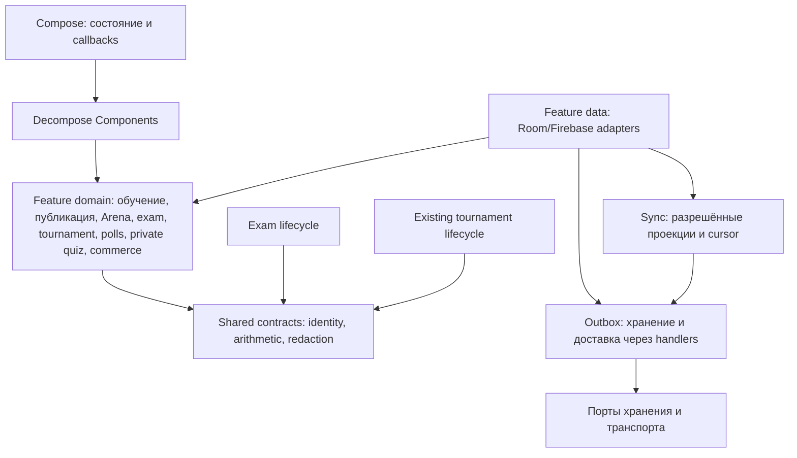
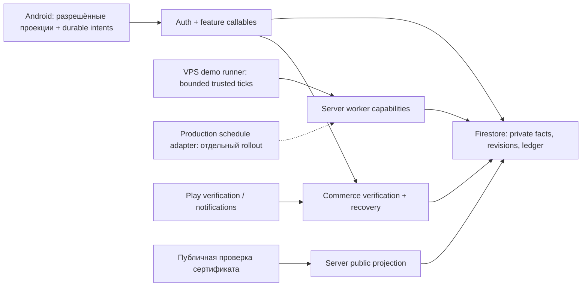

# Architecture Spine — SchoolQuiz

## Design Paradigm

**Layered Clean Architecture** с отдельными feature-владельцами состояния. Shared domain не зависит от Android/Firebase; data реализует domain-контракты; Decompose Components управляют представлением; Compose принимает состояние и callbacks. Root/factory собирает зависимости через Koin, lazy DI не выполняет I/O.

Объём — полный текущий MVP, включая контрольные, финальный экзамен и годовой сертификат. Это контракт согласованности между фичами; продуктовые числа и сценарии остаются в PRD и предметных companions. Наличие контракта не означает реализации экзаменов, завершённого редизайна или новой runtime-приёмки.

## Источники и приоритет решений

[PRD](../../prds/prd-schoolquiz3.0-2026-09-28/prd.md), его [addendum](../../prds/prd-schoolquiz3.0-2026-09-28/addendum.md) и принятые уточнения [.memlog.md](.memlog.md) определяют текущий объём. При конфликте применяется позднее явное решение владельца, конфликт сохраняется в истории.

[DESIGN](../../ux-designs/ux-schoolquiz3.0-2026-09-28/DESIGN.md) и [EXPERIENCE](../../ux-designs/ux-schoolquiz3.0-2026-09-28/EXPERIENCE.md) имеют `status: final`, `updated: 2026-10-01`: первый владеет визуальными ролями, второй — поведением. Они приоритетнее противоречащих HTML-примеров и прежнего UX discovery; [implementation-handoff](../../ux-designs/ux-schoolquiz3.0-2026-09-28/.working/implementation-handoff.md) отделяет принятый UX от отсутствующих адаптеров и приёмки. Идентификаторы UX O1–O12 сохранены в таблицах ниже. Разрешение текущей версии без FR-56 и поздние правила опросов, приватного квиза, призов и подарков уточняют старый PRD; прочие требования сохраняются. Принятие макетов не означает успешную операцию или готовый backend.

| Префикс | Предметный источник | Применение |
| --- | --- | --- |
| EXAM | [Экзамены, 08-29](../architecture-schoolquiz3.0-2026-08-29/ARCHITECTURE-SPINE.md) | AD-1–37 с поправками 09-29/30: обычный допуск редакции, отдельные lifecycle, неизменные сертификаты и отображение последней выдачи |
| SYNC | [Синхронизация, 08-31](../architecture-schoolquiz3.0-2026-08-31/ARCHITECTURE-SPINE.md) | Идентичность, outbox, права и cursor; поздние Arena proof/retained intents, online review и оплачиваемая подача уточняют AD-2/3/4 |
| MON | [Монетизация, 09-01](../architecture-schoolquiz3.0-2026-09-01/ARCHITECTURE-SPINE.md) | ADM-3/5/6/7/11/12/13/18/19 в границе MVP; ADM-16 только общий drop/opening, без старых five-ad box и общего cap 2; grant provenance и cumulative refunds уточняются поздним PRD |

Это предметные входы общего spine, а не его вышестоящие read-only родители. Их IDs не перенумеровываются; ссылка `EXAM:AD-19` не означает локальный `AD-19`. Старое требование pretest отменено; reviewer-offline, optimistic paid admission, удаление Arena intent по одному sent/terminal и destructive reset неприменимы. Весь каталог возможностей MON не добавляется в MVP автоматически.

Термины соревнования (AD-17): **турнир** — первая, отборочная часть; **чемпионат** — вторая, финальная часть с сеткой и матчами. «Соревнование» обозначает обе части вместе. Исторические `tournament*`/`event` identifiers и имена файлов сохраняются как технические обозначения всего lifecycle; их наличие не меняет пользовательские названия.

## Границы и зависимости

Стрелка означает зависимость; реализации data подставляются в domain-порты корневой сборкой.

## Invariants & Rules

### AD-1 — Владение разделено по фактам, а не по экранам `[ADOPTED]`

- **Binds:** все FR, все EXAM:CAP; SYNC:AD-7/10/12, MON:ADM-3/7.
- **Prevents:** второй владелец публикации, баланса или результата, появляющийся вместе с новым экраном.
- **Rule:** publication владеет допуском revision/manifest; learning — подтверждённым lesson progress; каждый режим — своей попыткой, временем и результатом; exam — admission и certificate issue/sign/verify; profile — read-only certificate projection/UI; economy — ledger/reserves/grants; review — assignments/evidence; communication — исходной видимостью обращений; config — версиями правил. Клиент хранит разрешённые проекции и свои durable intents, не назначает серверные факты. Между владельцами — явные domain-контракты и серверные операции; UI и shared core не пишут чужие таблицы. Polls владеет сериями, голосами и разрешённой статистикой; private quiz — доступом, лимитом/состоянием попытки и отдельными авторской/участнической проекциями; editor — черновиком и текстовыми аннотациями до submitted revision. История операций — read-проекция economy (AD-30), не новый ledger.

### AD-2 — Общие контракты не объединяют жизненные циклы `[ADOPTED]`

- **Binds:** FR-1–4,16–27,33–40; EXAM:CAP-2/4/5/9/10; EXAM:AD-1/5/7/21.
- **Prevents:** перенос непрерывных часов соревнования в обучение или exam ACK/sweeper в соревнование.
- **Rule:** общими остаются identity, canonical answers, redaction, идемпотентность и арифметика; Kotlin/server scoring соответствуют одним golden cases. Admission, выдача, таймер, переходы, terminal writer и последствия принадлежат режиму. Existing tournament callables/state machine сохраняются; экзамен получает отдельный lifecycle. Единое исключение из раздельных правил времени — подтверждённый общий переход после вопроса для онлайн-прохождений AD-31; он не объединяет их state machines. Provisioning не является стартом/покупкой/прохождением; готовый локальный ordinary/Arena question не получает обязательный сетевой gate. Категория не является типом вопроса: школьные квесты/гейм квиз допускают Арену, турниры и чемпионаты; курсы — без Арены, с приватными соревнованиями (турнир → чемпионат); опросы — с Ареной, без турниров/чемпионатов и EASY/HARD. Связь опроса с Ареной не превращает голос в scored lesson answer. Приватный формат — отдельный плоский HARD-набор; дополнительные Arena/tournament правила для него не назначены. Обычный редактор имеет single/multiple/ordering/fill; Polls использует отдельный редактор серии.

### AD-3 — Проверяется редакция; публикуется согласованный manifest `[ADOPTED]`

- **Binds:** FR-5–8,11–12,21,33; EXAM:CAP-3/14/19; EXAM:AD-10–16/23/25/35.
- **Prevents:** перенос одобрения на изменённый вопрос и смешение старого ключа с новым текстом.
- **Rule:** submitted revision и manifest зависимостей неизменяемы; evidence связывает revision, этап, модель и версию промпта (AD-32). Незатронутое одобрение переносится только с явным происхождением неизменных зависимостей. Успех одного вопроса не ждёт остальных; активация нового bank manifest атомарна и соблюдает минимум конкретного режима. Старая утверждённая редакция сохраняется при отказе новой; подтверждённая ошибка исключает старую из новых выборок. Карантин сохраняет историю, но не доступность: он может блокировать новые starts; frozen выданные банки не меняются. Обязательного pretest и допуска по накопленной статистике нет.

### AD-4 — Назначение проверки и её прогресс имеют серверное поколение

- **Binds:** FR-6–8,10,54; NFR-2/3.
- **Prevents:** случайное дублирование одного назначения и принятие записи прежнего исполнителя.
- **Rule:** slot=(submitted revision,direction,language,independent slot); сервер атомарно назначает reviewer+generation по действующей authorization policy. Запись требует owner/rights/generation/expected progress revision и stable operationId/body. Завершённый вопрос/сегмент и состояние перед финалом/возвратом сохраняются серверно; authoritative ACK обозначает подтверждённый прогресс. При потере связи/unknown работа приостанавливается, исходная запись повторяется и сверяется. Явный возврат/разрешённое переназначение повышает generation, сохраняя прогресс и авторство evidence; старое evidence не становится независимым подтверждением нового reviewer. Три направления не означают трёх людей; новые роли, AI-only и автоматический lease timeout не назначаются. Форма evidence и серверная полнота конкретной задачи следуют AD-26; текущий assignment-level score и boolean translation mapper не определяют целевой контракт. Приостановка сетевого сохранения review не останавливает уже активный TESTING-вопрос: его deadline и переход к следующему следуют AD-31. В текущем MVP не применяется: проверяющих-людей нет, проверку ведёт AD-32; код назначения удаляется (sprint-change-proposal-2026-10-26).

### AD-5 — Конфигурация активируется согласованной версией

- **Binds:** FR-9,19–21,29–32,41–51; EXAM:CAP-12/13/18; MON:ADM-11/13.
- **Prevents:** смешение тарифов из разных snapshots и скрытая переоценка согласованной операции.
- **Rule:** сервер атомарно активирует versioned config manifest с immutable component revisions и разрешённой клиентской проекцией; cache принимает целый согласованный snapshot, поздний ответ не затирает новую версию. Различаются bootstrap, stored/unknown freshness, verified-at-read и refresh error; ошибка сохраняет последний хороший snapshot, не создаёт нулевую цену. Новая mutation проверяет relevant shown terms сервером; изменившиеся платные условия требуют нового согласия. Accepted terms, bank и scoring revisions фиксируются в операции. Локализованные денежные цены принадлежат Play; новый TTL/network gate для готового offline-вопроса не вводится.

### AD-6 — Операция сохраняет исходное намерение и аккаунт `[ADOPTED]`

- **Binds:** FR-9–10,20–27,33–49,53–54; NFR-1/3; SYNC:AD-1/2/8/23.
- **Prevents:** новое списание после потерянного ответа и применение позднего ответа в новом сеансе A→B→A.
- **Rule:** ownerUid, account epoch, operationId и canonical body фиксируются до dispatch; ID/body не меняются на retry/restart. Повтор известного ключа возвращает сохранённый authoritative результат; другое тело под тем же ключом — конфликт. Owner+epoch проверяются на границах async работы до SDK и после ответа. Commit переживает cancellation; отмена coroutine не откатывает факт и не создаёт replacement operation. Новое пользовательское намерение отличается от продолжения неопределённого; stale/чужой ответ не меняет UI, cache или очередь текущего сеанса.

### AD-7 — Один outbox доставляет; feature доказывает разрешение `[ADOPTED]`

- **Binds:** FR-20,23–28,45–49,53–54; SYNC:AD-1/5/6/7/22–29; MON:ADM-5.
- **Prevents:** второй sender, бесконечный poison retry и удаление financial intent без доказанного исхода.
- **Rule:** сохраняются единый outbox/sender/mutex и зарегистрированные feature handlers; core не разбирает payload и не пишет feature state. Локальное действие и его enqueue/freeze атомарны там, где обещан durable intent; прямые записи очереди в Firestore запрещены. Принятый ordinary lesson unlock сохраняет offline unlock + provisional local nolics debit + outbox в одной Room TX, retry исходной операции и visible quarantine rollback; сервер подтверждает финансовый факт. Online-команды не становятся offline-покупками; запись исходного запроса для recovery не разрешает автостарт новой покупки. ACK требует валидного authoritative proof той же операции; exact-resolution TX согласует feature journal и queue. Arena retained SETTLE/CANCEL не удаляются по sent/terminal/expiry или общему карантину. Ошибки отдельных записей не останавливают остальные; conflict, prerequisite, retry и terminal quarantine имеют разные исходы feature.

### AD-8 — Проекции синхронизируются без вымышленных фактов `[ADOPTED]`

- **Binds:** FR-1–3,12,16–17,22,50–55; SYNC:AD-9/11/12/14/15/20/30/31.
- **Prevents:** пустой ответ, старая страница или sync error превращаются в подтверждённый ноль/удаление.
- **Rule:** entity version и change journal принадлежат серверу; persistent cursor=(changedAtMs,docId) продвигается лексикографически только после успешного применения во всех четырёх change journals; timestamp без docId теряет изменения с одинаковым временем. Ограниченные выборки продолжаемы; forced resync не удаляет pending intents. Account/session/page scopes не смешиваются; отсутствие элемента на странице не доказывает его удаление. Wallet available/reserved — общая серверная проекция, не сумма локальных tickets; read не создаёт профиль/регенерацию/ledger. Push несёт повод перечитать разрешённую проекцию. Unknown, stale, forbidden, not found и confirmed zero различимы; bounded refresh не вводит второй sender.

### AD-9 — Денежный эффект, receipt и право повтора согласованы `[ADOPTED]`

- **Binds:** FR-9–10,17–32,34,40–49; EXAM:CAP-13/15; MON:ADM-3/7/18/19.
- **Prevents:** двойная награда, отрицательный доступный остаток и потеря происхождения средств.
- **Rule:** economy — единственный владелец integer wallet и reserves; atomic transaction связывает баланс, stable operation key, receipt и effect marker. Многошаговый эффект использует доказанную durable idempotent chain, не объявляя reservation завершением. Проверяются conservation и неотрицательные остатки при конкуренции; цены/пулы берутся из frozen terms. Author royalty сохраняет собственный дробный carry; review использует отдельный carry AD-10. Promotion/season/assessment reward имеет устойчивый ключ основания и не повторяется от редактирования, replay или повторного размещения. Нолики и XP сохраняют weighted marginal bands, currency conversion и отдельные difficulty/allocated-time factors; коэффициент NEW-progress ordinary2 заменяется на ThemeTest3/FinalExam10, already-accounted final progress получает0.1. Это не дополнительный множитель всей награды. Final reward разрешён для каждой terminal попытки, включая провал/пересдачу, без выдуманного минимума; same-sitting retry не новая выплата. Reward-accounted maximum по user/assessment независим от latest certificate и theme best; снижение результата/renewal/новая попытка не сбрасывает оплаченный NEW progress. Максимум и payout receipt атомарны даже при округлённой нулевой сумме. Theme reward first-pass-only, с исходным accounted0 несмотря на прошлые неоплаченные провалы; certificate требует успешную сдачу. EXAM-TECH-1 C1/EXAM:AD-36 фиксирует ordinary EASY/HARD worth независимо от all-HARD answer timer, captured canonical pool basis, capped 5/15 или20 mean и независимое half-up XP/nolics из точного unrounded R. First-ever corrected theme pass платит один раз при отсутствии award, по frozen basis и b0. По принятому C2 уже выплаченные nolics/XP receipt и reward-accounted maximum сохраняются точно: без доплаты, взыскания, сброса или продвижения max по corrected score. Receipt сообщает факт, а не команду клиенту начислить.

### AD-10 — Review fee распределяется по завершённому циклу

- **Binds:** FR-9–10; NFR-1; review/economy/profile.
- **Prevents:** выплата за каждый этап, потеря дробей и распределение незавершённого бюджета.
- **Rule:** reward unit=(paid cycle,lesson,reviewer) объединяет направления; личный server level Li фиксируется первым принятым завершённым результатом этого unit. После полного цикла immutable settlement manifest фиксирует units/calculation version; старое сохранённое evidence не новая работа. Единица entitlement/burn/carry — десятая нолика: при ΣLi≤10P entitlement_i=Li, burn=10P−ΣLi; иначе доли 10P×Li/ΣLi округляются floors с раздачей остаточных десятых по убыванию остатка, tie по stable unit ID. Floating-point запрещён. Wallet credit=floor((oldCarry+entitlement)/10), newCarry=остаток; carry/credit/receipt согласованы атомарно, дробные обязательства покрыты escrow. Инварианты: 10P=Σentitlement+burn и oldCarry+Σentitlement=10×wholeCredits+newCarry. До полного цикла нет final burn; возврата review fee в MVP нет. В текущем MVP единиц вознаграждения нет: ΣLi = 0, burn = 10P (AD-32); формула и инварианты сохраняются.

### AD-11 — Arena разрешение и локальная попытка имеют один журнал `[ADOPTED]`

- **Binds:** FR-16–27; NFR-3/4; поздний Arena contract из addendum.
- **Prevents:** новый старт, seed, время или ответ при повторе маршрута и восстановлении.
- **Rule:** PREPARE record/dispatch раздельны; ticket фиксирует owner, attempt, terms, bank revision/hash и резерв до settle/явной отмены без нового TTL. Fresh claim только UNUSED/NONE/RESERVED с пустым checkpoint/revision0; clock/seed/order и LAUNCHED сохраняются атомарно. Ответ CAS связывает актуальные canonical bytes, а не старый pre-read hash; save-before-reveal обязателен. ResumeOnly/Continuable восстанавливают исходные ANSWERING/FEEDBACK/PAUSED/COMPLETING; StateKeeper не заменяет journal. Final CAS фиксирует body/endedAt; freeze атомарно сохраняет retained SETTLE, original SUBMIT_ATTEMPT и first intent. Arena не вызывает ordinary lifecycle в обход этого договора.

### AD-12 — Arena исход подтверждается строгой квитанцией `[ADOPTED]`

- **Binds:** FR-17,22–23,26–28,30,53–54; NFR-1/3.
- **Prevents:** terminal-флаг, FrozenLocally или исчезновение очереди показываются как оплаченный результат.
- **Rule:** settlement proof проверяет owner/ticket/attempt/request/bank binding и canonical исход; повреждённый/неполный proof не ACK. Cancel и settle имеют максимум один окончательный серверный эффект; CANCELLED с retained SETTLE остаётся доступным reconciliation. Новый rating intent меняет оценку из прежнего подтверждённого результата без replay; settlement и rating receipts различаются. Unknown HARD score не равен нулю; legacy/local result не новый receipt. Recovery/cancel доступны при пустом каталоге, неизвестном wallet и повреждённом банке; UI получает typed recovery, не queue-body.

### AD-13 — Цена, рейтинг и сезон используют полный допущенный состав `[ADOPTED]`

- **Binds:** FR-11,28–32; NFR-1/3/6.
- **Prevents:** цена из усечённой страницы и повторная сезонная выплата после прерывания.
- **Rule:** catalogue/quote/prepare используют одну eligible universe и серверную формулу PRD; уже выданные terms не переоцениваются. Заменяемая оценка принадлежит подтвердившему прохождение аккаунту. Сезон UTC фиксирует полный проверенный input, version/hash/checkpoints и единственную публикацию winner/award; технические budgets не ограничивают участников. Победа/рейтинг не заменяют кураторское продвижение и не выдают роль. Изменение pricing/season проходит отдельный review до включения.

### AD-14 — Допуск к экзамену отделён от покупки и текущей готовности банка `[ADOPTED]`

- **Binds:** EXAM:CAP-1/3/7/9/11–13/15–17/19/20; EXAM:AD-8–14/18/20/25–29/34–36.
- **Prevents:** купленный непройденный урок открывает final или архивный count разрешает несуществующую выборку.
- **Rule:** lesson progress подтверждает learning owner; theme start ждёт доставки нужных результатов и отказывает до списания при ResultsNotSynced/недостаточном пуле. Theme admission/result и final result имеют разные identities; обычная theme admission/best-result проекция монотонна, correction проходит отдельный EXAM:AD-24 путь. Это не выбирает текущий сертификат: его latest-issuance правило задаёт AD-16. Theme test — 5 easy+15 hard, final — 20 hard; все вопросы зачётные, draw фиксируется. Доступный theme draw разрешает контрольную и ниже общей сертифицируемости курса; final дополнительно требует существующий certification minimum: не менее 12 соответствующих контрольных тем, каждая с ≥100 EASY и ≥100 HARD допустимыми вопросами. Start и charge атомарны, один open sitting на exam возвращается без второго расхода; cooldown имеет user-scoped ключ theme:ID на скользящие 24 часа / final:ID на 168 часов (7 суток), начинается от terminal outcome, включая timeout/abandonment. Recovery той же open sitting не создаёт новое списание или новую точку cooldown. First-pass theme reward не выдаёт сертификат. Новый final использует latest approved courseVersion; passed переносится по (courseId,stable themeId): изменение вопросов не требует пересдачи сданной темы, досдаются новые темы, archived extras игнорируются. Active sitting сохраняет frozen inputs; подтверждённая ошибка скоринга остаётся отдельной versioned correction, не обычным обновлением курса. EXAM-TECH-1 C3 связывает confirmed EASY coverage с exact question/revision manifest, validated raw evidence и union успешных tokens, включая больше20 вопросов. Start до charge атомарно перепроверяет current manifest/confirmed generation; upload ACK, stars/count или legacy unknown не доказывают полноту. Existing offline learning и stable passed-theme carry сохраняются. До нового final start та же start/charge TX также проверяет readiness и current/applied correction generation: pending/unavailable recomputation отказывает до списания, stale passed projection не разрешает старт. Единая generation агрегата темы учитывает каждую новую terminal sitting и каждую correction. Все writers согласуют её транзакционно; materializer проверяет поколение всех входов, поэтому старый пересчёт не может затереть более новую успешную сдачу. Принятая цена — 1 полный заряд за контрольную и 2 за финал (100/200 внутренних points). Источник уже определён spec-charges CAP-1: только STANDARD, без plasma/split. UX-O1 как продуктовый вопрос снят; legacy final300 нужно согласовать с принятыми200 до включения реального debit. Reward basis C1 не меняет источник списания.

### AD-15 — Экзамен скрывает ключи и завершается без клиента `[ADOPTED]`

- **Binds:** EXAM:CAP-2/4–6/10/14/21; EXAM:AD-2–4/6/17/21/29–33/37.
- **Prevents:** восстановление продлевает дедлайн, ответ перезаписывается retry и открытый клиент становится условием terminal result.
- **Rule:** экзаменационный server lifecycle выдаёт только разрешённый текущий вопрос; первый ACK закрепляет deadline, повтор возвращает тот же. Ответ first-write-wins по sittingId/questionIndex, canonical IDs преобразуются ровно один раз; никакого correctness/verdict/key в submit/DTO/UI/Room/logs. Один логический terminator пишет terminal через CAS/fencing, foreground только advances/reads; Ожидание первого ACK ограничено существующим стартовым контрактом EXAM:AD-30; затем применяется общий AD-31: expiry вопроса автоматически закрывает его без ответа, 60 секунд на следующий начинаются с принятого своевременного ответа либо исходного deadline, а не с reconnect/позднего worker. Result выдаётся после terminal, open имеет typed state. Исходная sitting и приватная telemetry сохраняются; correction создаёт версию, signals/статистика не отменяют результат автоматически. Public advice не идентифицирует проваленный вопрос. Каждый вопрос контрольной и финального экзамена получает обычное HARD-время: max(5,roundHalfUp(chars*0.24)), по текущим правилам подсчёта текста/вариантов и image=100 символов. Дополнительного examFactor0.75 нет, включая 5 EASY контрольной; их сложность и состав теста не меняются. Timer rule фиксируется в sitting. EXAM-TECH-1 C2 задаёт cumulative original-slot exclusions, nested truncation scorer, captured pass mark, CAS correction head и отсутствие numeric result/admission proof при all-excluded или missing evidence. Correction head и recomputed theme admission/best атомарны, либо одна TX с head фиксирует durable correction generation/pending barrier; materialization принимает только текущие result/correction version и generation, obsolete write не затирает новые данные. Active sitting сохраняется. Исправление не сбрасывает исходный cooldown и точно сохраняет settled reward receipt/accounted max без доплаты, взыскания или продвижения от corrected score.

### AD-16 — Сертификат хранит исходное свидетельство; отображается последнее `[ADOPTED]`

- **Binds:** EXAM:CAP-8/16/18/21; EXAM:AD-19/24/28/37.
- **Prevents:** контентная correction меняет выданное свидетельство, best-score скрывает последнюю сдачу или поздняя подпись старой выдачи заменяет новую.
- **Rule:** только успешный final создаёт серверное годовое свидетельство с sitting, score/pass mark, bank/course snapshot и собственными исходными датами. Новая сдача допустима до и после истечения срока по обычным admission/cooldown/charge правилам; каждая новая успешная sitting получает отдельную issuanceId и год от её earning outcome, прежние свидетельства сохраняются неизменными. По умолчанию показывается последнее по авторитетной серверной хронологии заработанного результата, даже с худшим проходным score; порядок подписи и лучший score не выбирают текущий сертификат. Провал не создаёт выдачу и не заменяет текущую. Для каждой успешной final sitting terminal success, неизменяемый факт выдачи (issuanceId, resultVersion, claims, даты, keyId, earning order) и durable работа подписи/публикации атомарны. Подпись вне TX, pending явно видим; retry той же sitting исполняет ту же выдачу без нового score check, identity или сдвига дат. Позднее завершение старой подписи не вытесняет новую выдачу. Публичная серверная проверка возвращает разрешённые frozen claims/status. Понижающая correction из-за ошибки нашего задания не меняет ID, подписанный снимок, даты, исходный срок или действительность выданного сертификата и не продлевает год; исправленный результат хранится отдельно. Theme best-result/admission не меняется. Сертификат подтверждает сдачу аккаунтом, не личность/аккредитацию; иные основания отзыва отдельно. Пересчёт прежнего провала в проходной результат не выдаёт сертификат за старую sitting: нужна новая успешная сдача по обычным admission/charge/cooldown правилам. Уже заработанное при исходном успешном terminal право на выдачу, включая pending подпись, сохраняется; correction не создаёт новый earning order.

### AD-17 — Турнир и чемпионат сохраняют отбор, допуск и фонд `[ADOPTED]`

- **Binds:** FR-33–40; NFR-1/3/4/6; названия частей соревнования; UX-O4/access.
- **Prevents:** первые 501 попытка становятся всем отбором, повторный worker меняет опубликованную сетку или клиенты по-разному решают допуск в приватный турнир курса.
- **Rule:** существующие callables/controllers сохраняют private forms и server-only operations; bank достаточен до резерва полного фонда. В пользовательском языке турнир — первая отборочная часть соревнования, чемпионат — вся вторая финальная часть с сеткой и матчами. Приватный турнир курса доступен всем, кто скачал соответствующий курс, а также по действительной ссылке на турнир; ручной список выбранных организатором участников не требуется. Сервер подтверждает одно из этих оснований допуска, сохраняя обязательные аккаунт, регистрацию/отбор и сроки турнира; доступ не раскрывает private forms и не обходит этапы. Оба пути допуска, включая ссылку, действуют только во время турнира: серверное окно [qualification.startsAtMs, qualification.endsAtMs). До начала и с момента окончания турнира новые входы закрыты; поздний запрос или retry не создаёт новый вход. Возврат прежнего receipt сохраняет историю, не открывает новый доступ. В чемпионат проходят только отобранные по действующему результату турнира; истечение ссылки не отменяет их право на матчи чемпионата. Правило не удаляет историю и не назначает срок ссылки отдельного индивидуального private quiz. Единый контракт подтверждения скачанного курса/ссылки и проверки этого окна требуется до реализации допуска (UX-O4/access). Полный validated cohort/input hash и server-fixed calculation/rounding version проходят resumable VALIDATE→REDUCE→SOLVE→PROJECT→PUBLISH→PUBLISHED с cursor/revision/lease/fencing. Сохраняются LS-модель, exact rational система ≤3×3 и rounding до Number; published ranking/bracket immutable. Равная HARD form/fingerprint пары, сроки/ready/ответы и technical outcomes принадлежат серверу; reconnect не останавливает часы. Marker/event/award согласованы атомарно или durable chain; reserved=paid+returned+remaining, terminal remaining=0. Resource exhaustion требует продолжения/завершения, не hidden cap/permanent Pending/автоотмены. Новый CREATE принимает динамический упорядоченный список призовых мест: frozen фонд равен сумме каждой строки один раз, без второго третьего места; reserve, ranking→place mapping и payout используют ту же версию списка. Старый fixed first/second/third DTO не подставляется под новый UX. До серверного CREATE/резерва по новому списку требуется единый контракт rank/tie/technical-outcome mapping (O2); сохранить черновик формы можно, принять финансовое обязательство без этого договора нельзя. PROPOSE не CONFIRM; предложения и подтверждения отдельных слотов сохраняются, выбор radio их не отменяет. Согласованный слот неизменяем; разрешённая owner/epoch read/ack-проекция восстанавливает CONFIRM и READY каждого участника. В чемпионате при C=конец этапа−1 час−длительность формы предложение допустимо до C, слот между server now и C, подтверждение до C и не позже слота; READY в [слот, слот+1 час). Только сервер после готовности обоих начинает тот же матч; новая «очерёдность хода» не вводится.

### AD-18 — Покупка и возврат связаны с исходным начислением `[ADOPTED]`

- **Binds:** FR-41,43,45–49; MON:ADM-5/6/7/11/12/19.
- **Prevents:** callback/RTDN начисляет товар, чужой аккаунт присваивает token и refund уничтожает другие grants.
- **Rule:** authoritative Play verification и account/app/product/order/quantity binding предшествуют grant; ACK/consume следует подтверждённому состоянию/типу товара. Permanent token fence, V2/V1 original quantity и cumulative immutable refund receipts/monotonic refundableQuantity сохраняются. RTDN запускает проверку, не денежную команду; ambiguous verification остаётся pending и не снимает fence одновременно с выдачей. Legacy repair bounded/resumable, прежний full key сохраняется. Sales-off не отключает query/recovery/refunds. Premium возврат затрагивает неиспользованный остаток конкретного grant; gold multi-quantity и запрет premium quantity>1 не обходятся до отдельной проверки Play policy.

### AD-19 — Premium и коробки вычисляются из происхождения и времени `[ADOPTED]`

- **Binds:** FR-41–45,48; MON:ADM-3/8; ADM-16 только общий drop/opening.
- **Prevents:** countdown начисляет ресурс и одна ежедневная серия стирает независимый источник коробок.
- **Rule:** server-owned grants/used/remaining определяют premium intervals и обе регенерации с резервами; независимый hasPremium/локальная анимация не источник истины. Один тип коробки и общий запас сохраняют происхождение ordinary daily/premium daily/прочих наград. Ordinary daily даёт максимум одну коробку в день, premium daily — отдельный источник; прочие награды не расходуют эти лимиты. Старые общий cap 2 и коробка за пять реклам не применяются. Offline daily observations не безусловное доказательство посещения или защиты от перевода часов. Opening online фиксирует один результат/receipt до показа награды; повтор возвращает его. Полная цена premium видима, нормализация за 30 дней — только сравнение. Обычная коробка за серию после 10 дней подряд начисляется автоматически при входе независимо от Premium. Premium-подарок — другая операция: явное «Получить подарок» на существующем экране с рекламой, без просмотра рекламы; вход не запускает Premium-claim. Два источника имеют отдельные ключи/receipts и общий запас; доступность/суточные ограничения источника сохраняются, Premium не даёт безлимитных повторов.

### AD-20 — Общий inbox сохраняет права исходного обращения `[ADOPTED]`

- **Binds:** FR-5–15,33–40,54; NFR-2.
- **Prevents:** объединение списков раскрывает приватную ошибку, raw формы или чужую историю.
- **Rule:** сервер проверяет author/reviewer/curator/account права и формирует разрешённые bounded views. Public comments и private lesson-error — разные records/access policies; inbox объединяет проекции без расширения readership. Ошибка относится к целому уроку, не выдаёт повторно вопрос/ответ и не даёт права редактировать. Исправление возвращается через revision/review/publication. Будущие формы/ключи, tokens, original order IDs и private answer payloads исключены из UI-диагностики/общих логов. Один подозрительный показатель не банит; новые DMs/AI-only/Telegram/автоперевод не возникают из общей инфраструктуры. Приватное сообщение/ошибка по уроку адресовано разрешённому автору этого урока; общий inbox не даёт reviewer/curator права читать его только из-за роли и не обещает двусторонний чат или ответ. Существующее публичное обсуждение сохраняется отдельно.

### AD-21 — Состояние действия не сводится к успеху или spinner `[ADOPTED]`

- **Binds:** FR-1–56; EXAM:CAP-1–21; NFR-4/5.
- **Prevents:** redesign скрывает recovery, выдаёт local saved за confirmed и останавливает чужой таймер.
- **Rule:** presentation различает local saved, pending, unknown, stale, rejected, confirmed, forbidden, empty и retry/recovery; компоненты получают typed projections. Loading причина следует фактической работе; готовый вопрос показывается сразу, без искусственной задержки/нового launch-SLA/процентов. Семантические Continue/Info/Back, RU/UK/EN, rotation/background/restore и предусмотренные режимные задержки сохраняются. Золотой premium экран, две кнопки после урока, inbox и история операций следуют финальным DESIGN/EXPERIENCE от 2026-10-01. FR-56 перенесён владельцем в отдельную будущую задачу: текущая версия без юзергайда, его подсказок и пустых заглушек; это не blocker её выпуска. Пороги/тексты/места/закрытие/повтор/миграция просмотров определяются до включения; триггер будущего гайда — набранный опыт, не первый вход в функцию. UI не раскрывает raw queue/bank и не закрывает delivery сам. Back и восстановление маршрута сохраняют identity/контекст/позицию и сами не создают попытку, платёж или голос. Кураторское меню доступно по long press и равнозначному semantic action, только для разрешённых «Разместить»/«Снять» с подтверждением; короткий tap открывает урок. 24 исключения из обзора макетов не исключают обязательные продуктовые статусы/recovery и не разрешают повторный показ отвергнутых макетов под другим именем.

### AD-22 — Обновление добавочное, rollout совместимый `[ADOPTED]`

- **Binds:** FR-47–49,55; NFR-3/7; SYNC:AD-13/17/18.
- **Prevents:** новый клиент очищает непустую установку и rollback стирает подтверждённые деньги.
- **Rule:** миграция определяется фактической schema, сохраняет tables/data/auth/history/install identity/pending и старые receipts; destructive fallback/uninstall/reset запрещены. Отсутствующий/повреждённый restore input не подменяется пустым стендом; исходный export сохраняется. Порядок: server → совместимые migrations/new client → flags → сценарии → owner review → отдельно разрешённый KMP → отдельно разрешённый public. Rollback не возвращает старую БД поверх новых финансовых фактов; остановка продаж сохраняет recovery/refunds. Dependency-only изменения отделены от financial changes и проверяются на актуальной базе кандидата.

### AD-23 — Worker capability отделена от среды её вызова `[ADOPTED]`

- **Binds:** FR-32,36–40,53; EXAM:CAP-10/21; EXAM:AD-30; NFR-3/6.
- **Prevents:** отсутствие production scheduler блокирует demo proof и клиент становится владельцем завершения.
- **Rule:** bounded server-owned sweeps сохраняют cursor/checkpoints/lease и продолжаются после crash; повтор/конкуренция fenced, client не задаёт server time/worker operations/budgets. Demo controlled ticks вызывают ту же capability без внешнего Scheduler/PubSub по умолчанию. Production schedule — отдельный deployment adapter с capacity/lag/recovery evidence до запуска. Численные budgets ограничивают invocation, не population. Работа/хранение — VPS; адреса/сеть берутся из environment registry, demo изолирован от production credentials и public ADB/портов. Planning не запускает службы, устройства, сборки или финансовые сценарии. EXAM-TECH-1 C4 фиксирует bounded sweep/wrap/fencing и non-starving poison work; existing Firebase v2 onSchedule остаётся production wake-up adapter. Signing вне TX проверяет frozen claims/key и публикует через CAS identity/digest/fence; rotation сохраняет pending-bound signing и historical verification. Provider/algorithm/env/secrets/cadence/retention/runbook evidence проверяются до разрешённой активации.

### AD-24 — Приёмка доказывает текущий кандидат целиком `[ADOPTED]`

- **Binds:** FR-1–56; EXAM:CAP-1–21; NFR-1–8.
- **Prevents:** исторический PASS, mock Play или local proof закрывает новую серверную реализацию.
- **Rule:** candidate identity связывает source/backend/APK/schema/config/flags; каждый run хранит среду/время/hashes и PASS/FAIL/NOT RUN/SKIPPED/INTERRUPTED, не затирая failures. Canonical ciCheck дополняют реальные Auth/Firestore/HTTP/rules, непустая migration, два аккаунта/устройства, offline/restart/lost response/races и отдельно Play sandbox. Arena E2B требует matching SETTLE+RATE_LESSON; экзамены — start→answers→sole termination→result→issue→public verify и correction без изменения certificate. Node tests регистрируются в runner; mapper проверяется ненулевыми полями. До offline launcher исправляется известный RED: ровно пять известных quiescence counters numeric zero. Одна тяжёлая сборка одновременно, физические устройства, clearState:false, trusted server test clock; demo fixtures только создают условия. Для переноса final UX отдельно нужны реальные Compose fontScale 2.0, TalkBack, keyboard/DPAD и contrast после композиции: профиль/runner, шесть осей с обеими сериями, локализованные трофеи, точные диапазоны с повторяющимися словами и undo/redo. HTML/fixture PASS этого не доказывает; обнаруженный конфликт contrast решается явно, не самовольной заменой принятых цветов.

### AD-25 — Общая семантика NOIR принадлежит дизайн-системе `[ADOPTED]`

- **Binds:** DESIGN tokens/components; EXPERIENCE S1–S11; все presentation features.
- **Prevents:** фичи по-разному кодируют одинаковый статус/ресурс, а компоненты назначают финансовые факты.
- **Rule:** SchoolQuizTheme/NoirTheme и `android/core/designsystem` централизуют роли/токены финального DESIGN; экраны используют согласованные семейства компонентов, domain/presentation поставляют значение, доступность и callbacks. Названия семейств в DESIGN не навязывают новые Kotlin-классы. Цвет дополняется текстом/семантикой; fixed HTML px не отменяют scalable text и hit region ≥44dp. При обычном масштабе сохраняется принятая композиция, при увеличении — доступ ко всем данным/действиям. Профиль — одна паутина с двумя сериями, включая нулевую, с читаемыми шестью осями и трофеями; system screenshot не требует нового export pipeline. Значимые async переходы объявляются без захвата фокуса, таймер не прерывает каждую секунду. Палитра, assets, размеры, RU/UK/EN и принятые визуальные исключения остаются в DESIGN; новые tablet/desktop layouts не выводятся из Android MVP.

### AD-26 — Review сохраняет явное решение для конкретной единицы проверки `[ADOPTED]`

- **Binds:** FR-6–8; EXPERIENCE F9; UX-O5; AD-3/4/10.
- **Prevents:** оценка assignment заменяет решение по вопросу, а непустой перевод автоматически считается проверенным.
- **Rule:** TESTING фиксирует 1–3 звезды конкретному questionId/revision после ответа; одной независимой оценки достаточно. Серверная константа проходного качества по умолчанию равна2:1 — не прошёл,2/3 — прошёл. Результат связывает оценку, применённый порог/config revision и assignment generation; retry не переоценивает его по новому порогу. Прошедший TESTING вопрос ещё требует остальных предусмотренных проверок; quorum/средний балл разных вопросов не заменяет поштучный допуск; валидация — «Подтвердить»/«На доработку» по вопросу и этапу, переход после authoritative ACK. При возврате автор видит непройденный этап без поля причины; причина снятия уже опубликованного урока куратором — отдельное правило. Private quiz не проходит публичную доработку. Translation draft/evidence связывают submitted/source/target revisions, questionId и segmentId; смена пары меняет реальный исходник и восстанавливает собственные решения/позицию. Translation review имеет unchecked/correct/error; повтор выбранного решения возвращает unchecked. Missing translation нельзя принять как correct, error доступен. Следующий вопрос требует решений всех его сегментов, финальная отправка — всех сегментов всех вопросов, проверяемых сервером; ни boolean default, ни наличие текста не evidence. Назначение/generation/operationId/online recovery наследуют AD-4/6. UX-O5 порог/количество закрыты: одной оценки достаточно, ожидания дополнительных проверяющих нет; прежняя senior-band агрегация не создаёт нового quorum для этой ветки. Уже принятое завершение review cycle включает обоснованное отклонение; формула и момент выплаты AD-10 сохраняются. Окончательное прекращение незавершённого цикла — отдельный условный сценарий O11, не повторный вопрос о нормальном завершении. В текущем MVP TESTING-оценка 1–3, порог и проверка перевода по сегментам не применяются: вердикт PASS/FAIL с причиной даёт AD-32, перевод — автоматический шаг с линтером.

### AD-27 — Аннотации относятся к конкретному тексту, полю и вхождению `[ADOPTED]`

- **Binds:** authoring/translation/publication/redaction; EXPERIENCE editors; UX-O6.
- **Prevents:** одинаковое слово получает чужую защиту, правка сдвигает blank к другому ответу или раскрывает ключ игроку.
- **Rule:** editor владеет текстом вместе с устойчивой идентичностью поля/аннотации и привязкой к revision/точному вхождению; protected range, blank и correctness — разные значения. Одна аннотация не пересекает поля и не распространяется на другие одинаковые слова. Edit/undo/redo восстанавливают текст и метки согласованно, снятие метки оставляет текст. Защита перевода — общий этап после генерации урока для вопроса, ответов и пояснения; FillBlank — обычный текст с выделением, без видимых маркеров/дублирующего списка ответов, 1–3 разных пропуска и 5/10 уникальных кандидатов. Пустой новый слот отличается от очищенного существующего вопроса; неполный невалидный ввод сохраняется. Формат сериализации, единица индексации и миграция — один контракт O6 до независимых editor/adapter работ; HTML не назначает схему. Player/exam redaction исключает аннотации, раскрывающие ответы; новый wire format не отменяет существующее удаление protected answer metadata.

### AD-28 — Голос опроса — один подтверждённый набор участника `[ADOPTED]`

- **Binds:** Polls editor/vote/statistics; EXPERIENCE F10/S9; UX-O7; AD-6/8.
- **Prevents:** тап по checkbox становится отдельным голосом, повтор меняет статистику или проценты считаются от числа отметок.
- **Rule:** серия сохраняется единым draft; вопрос содержит один/несколько выбираемых вариантов (2–8), без correctness/сложности/уроковой иерархии. Один вопрос на полном экране: до отправки набор изменяем, непустой набор фиксируется «Проголосовать»; только после подтверждения доступны распределение и «Далее»/«Готово». До собственного принятого голоса серверная проекция скрывает распределение; preview не голосует. Percent(option)=100×число ответивших участников, выбравших option / число ответивших на вопрос участников; каждый участник один раз в знаменателе, сумма процентов может превышать100. Unknown не нулевой счётчик. Retry сохраняет operationId/body, а серверная уникальность participant/question исключает второй голос даже при новом ID; смена принятого набора не выводится из retry. Единая идентичность revision/series/question и правила сохранения/продолжения фиксируются в O7 до vote API, без автоматического наследования exam/Arena lifecycle.

### AD-29 — «Приватные квизы»: попытка и её видимость определяются сервером `[ADOPTED]`

- **Binds:** private author/entry/runner/statistics; EXPERIENCE F11; UX-O4; AD-6/8/20.
- **Prevents:** скрытый балл доступен в DTO, повтор входа расходует лимит, два устройства создают лишние попытки или закрытая ссылка разрешает новый start.
- **Rule:** категория и её вход называются «Приватные квизы»; отдельный квиз — плоский HARD-набор, участник входит аккаунтом SchoolQuiz. Технические IDs этим названием не меняются. Автор выбирает срок ссылки: без конечной даты до ручного отключения либо до заданного им момента; отключить вручную можно и раньше заданного срока. Сервер владеет состоянием доступности и необязательным абсолютным сроком. Новый start разрешён только при включённой ссылке и (отсутствии срока либо server now < expiry); эта проверка атомарна с проверкой и расходом лимита попыток. В момент expiry новые starts уже закрыты; retry старой операции сохраняет исходный receipt, а не выдаёт новую попытку. Отключение/expiry закрывает только новые starts: уже подтверждённая сервером активная попытка сохраняет право закончить по исходным identity, таймерам и AD-31. Сервер однозначно упорядочивает start и закрытие доступа; ранее начатая попытка не обрывается из-за ссылки, но её собственные сроки не продлеваются и отложенное продолжение не появляется. Автор задаёт show-result и целый лимит ≥1. Изменение лимита сохраняет число уже начатых попыток; подтверждённую активную попытку разрешено закончить по исходным срокам даже после уменьшения лимита. Каждый новый start атомарно проверяет доступ и startedCount < текущий лимит, затем увеличивает счётчик. Повышение лимита допускает новые starts лишь в пределах оставшейся разницы; понижение не сбрасывает историю/счётчик и не прерывает начатую попытку. Изменение лимита и start имеют единый серверный порядок; retry исходной операции не расходует лимит повторно. Приватное одиночное прохождение — один заход без отложенного продолжения. Допустимо только техническое восстановление исходной активной операции/вопроса в пределах исходных дедлайнов и AD-31; потерянный ответ не создаёт новый start. Неизвестный/исчерпанный остаток не разрешает новую попытку. Заряды STANDARD/PLASMA не используются ни для входа, ни для подсказок/оплаченных пропусков; автоматический пропуск по времени не считается платным правильным ответом. Другая плата вместо зарядов не вводится. Текущая серверная настройка show-result действует для всех попыток, включая завершённые ранее; она не замораживается при start. При false участнику выдаётся только подтверждение завершения, без N/M и процента; true разрешает только его собственный результат. Автор включил показ — прежние участники получают доступ к своим результатам; выключил — эти результаты скрыты. Это меняет разрешённую проекцию, а не сохранённые ответы, балл, факт завершения или счётчик попыток. Read/retry заново учитывают текущую видимость; подтверждённое изменение настройки инвалидирует прежнюю участническую проекцию, поздний ответ не восстанавливает скрытые данные поверх новой версии разрешения. Авторская статистика доступна в обоих случаях по отдельному authorized scope. Ни UI hiding, ни account-local draft не заменяют серверную фильтрацию. Для нового квиза приняты defaults: лимит 1 попытка, show-result=false, ссылка без конечной даты. Автор может изменить эти значения; загрузка существующего квиза сохраняет его настройки, а не подставляет defaults заново. По истечении окна восстановления AD-31 попытка завершается с причиной timeout, продолжить её позже нельзя. Итог считается по всему зафиксированному квизу по существующему скорингу режима: принятые вовремя ответы сохраняются, все оставшиеся вопросы, включая невыданные, учитываются как без ответа. Процент не ограничивается отвеченной частью; paid-correct эффекта у пропусков нет. Итог участнику доступен по текущему show-result, авторская статистика сохраняется при любом флаге; нового pass/fail порога или возврата попытки не вводится. Продуктовые правила UX-O4 приняты; автопродление/перевыпуск/повторное включение этим решением не назначены; не наследовать плату/таймер/pass-fail экзамена и не вводить гостя/пароль/приглашение.

### AD-30 — История операций читает разрешённую проекцию economy `[ADOPTED]`

- **Binds:** economy/API, account history, author lesson earnings; EXPERIENCE F9; handoff «История операций»/O10.
- **Prevents:** клиент читает чужой ledger, начисляет из строки истории или суммирует несопоставимые ресурсы.
- **Rule:** одна economy read-проекция обслуживает общую собственную историю начислений/расходов из drawer и «Начисления» конкретного авторского урока. Сервер проверяет account/lesson права; record identity, дата, основание, signed amount, ресурс и статус сохраняются между scopes. Pending не подтверждённый доход; разные ресурсы не складываются, loading/empty/error/unknown различаются. Группировка по дате, фильтры и раскрытие записи сохраняют контекст; bounded continuation/order и состав разрешённых полей фиксируются до adapter (O10). Смена owner/epoch отсекает поздний ответ. История не исполняет денежные команды и не раскрывает tokens/order secrets/private payloads; источник подтверждённых сумм — существующие ledger/receipts, не HTML v52.

### AD-31 — Онлайн-вопрос истекает до окна загрузки следующего `[ADOPTED]`

- **Binds:** все онлайн-прохождения, включая HARD, private quiz, экзамены, турниры и чемпионаты; AD-2/6/15/17/29.
- **Prevents:** потеря сети останавливает вопрос, 60 секунд превращаются в дополнительное время ответа или каждый retry продлевает попытку.
- **Rule:** исходный авторитетный deadline вопроса идёт независимо от соединения. Если своевременного принятого ответа нет, expiry автоматически закрывает вопрос как пропущенный/без ответа по скорингу режима, без paid-correct эффекта. Если остались вопросы, затем действует общая серверная константа ожидания подключения и загрузки следующего, по умолчанию60 секунд. Начало — закрытие предыдущего вопроса: принятие своевременного ответа либо его исходный deadline; не обнаружение разрыва, reconnect, клиентский запрос или поздний проход worker. Deadline и применённая конфигурация сохраняются; retry не возвращает пропущенный вопрос и не заменяет уже принятый ответ. До реализации переходов обязателен единый delivery/ready-ACK контракт ONLINE-O2: он называет событие завершения окна, authoritative receipt и связь с запуском времени ответа следующего вопроса. Между завершением окна загрузки и началом времени ответа нельзя оставлять неограниченную паузу. EXAM:AD-3 уже связывает первый подтверждённый показ с deadline; применение этого события в других режимах требует явной интеграции, не отдельного локального выбора. Время ответа следующего не запускается повторно. Пока вопрос активен, сетевое окно не обрезает его время ответа; после последнего вопроса лишних60 секунд нет. По expiry окна режимный серверный владелец завершает попытку, исход/награда определяются существующим mode contract; не объявлять timeout победой или новой платной попыткой. Первый вопрос сохраняет отдельный bounded стартовый контракт; новое число для начального ACK здесь не выбрано. Готовый следующий вопрос показывается сразу, без ожидания60 секунд. Офлайн-сценарии ordinary/Arena не становятся онлайн. Старые общие deadlines прохождения турнира и матча чемпионата требуют согласования с полным окном60 секунд (ONLINE-O1); до этого нельзя утверждать соответствие существующего runtime или молча урезать окно/продлить этап.

### AD-32 — Проверку выполняет конвейер нейросети `[ADOPTED 2026-10-26]`

- **Binds:** FR-5–10 и уточнение PRD 2026-10-26; CAP-3/4/27.
- **Prevents:** угаданный вердикт при сбое модели, исполнение инструкций из текста урока, правку авторского текста моделью, двойную обработку одного урока.
- **Rule:** подача → серверная очередь → отдельный обработчик на VPS по образцу `arena-season-worker` (AD-23), не триггер функции: вызов модели с поиском длится минутами. Один квест за раз, уроки по одному; контекст — название квеста и путь категории. Этапы «Слова» → «Факты», у каждого свой скилл (промпт) с версией. Ответ модели строго по схеме; линтер (код) проверяет схему и при ошибке возвращает модели именованную ошибку, не более трёх повторов, затем состояние REVIEW_DELAYED — не REJECTED (AD-8). Вердикт по вопросу PASS/FAIL с причиной — неизменяемая запись (revision, stage, model, promptVersion, sources, rationale, attempts). Текст урока передаётся как данные внутри разграничителей; модель не возвращает правок текста. Задание имеет идентичность (submission, lesson, stage, attempt); повтор не создаёт второго вердикта. После прохождения — шаг перевода: определение языка источника, перевод на остальные языки приложения, линтер структуры (число вариантов, ключ, защищённые диапазоны AD-27). Ключ API хранится на VPS вне Git; модель и бюджет — после пробных прогонов (SPEC OQ-10). Вкладка «Решения» читает записи серверной проекцией с проверкой роли admin; отметки ✓/✗ хранятся отдельно и не меняют вердикт или публикацию.

### AD-33 — Предложение автору — одна запись для трёх входов `[ADOPTED 2026-10-26]`

- **Binds:** CAP-6, CAP-27; FR-5, FR-11–15.
- **Prevents:** утечку секретных ключей через копию, применение непроверенной или устаревшей правки, изменение чужого текста без решения автора.
- **Rule:** proposal = (kind REPORT | COPY_EDIT | NEW_LESSON, целевой урок или узел курса, base revision, proposer, payload revision). Все виды проходят этапы AD-32 до показа автору. Маршрут — владельцу целевого урока или курса; push-тип с общим именем и сторожем (testing.md). Копию собирает сервер из проекции игрока: тексты и варианты без секретных ключей. Одобрение атомарно применяет ровно проверенную редакцию: COPY_EDIT → новая редакция урока (автор прежний, предложивший — соавтор в истории); NEW_LESSON → урок в курсе с автором-предложившим; REPORT → отметка «к исправлению». Если base revision не равна текущей — STALE, применение отказывает. Плата по виду: 0 / 100 × изменённые вопросы / 1000 по AD-9/10 без выплат; решение автора бесплатно. Выданные попытки сохраняют банки (AD-3). Права на раздел «Предложения» проверяет сервер (AD-20).

## Deployment и операционный seed

Стрелки здесь означают вызовы/обмен. Production показан как будущий разрешаемый rollout, не действующее окружение.

Seed принадлежит коду: Android-first KMP, Decompose/Compose/Koin/Room; Firebase Auth/Firestore/Cloud Functions, Node 22. Наблюдённые pins: Kotlin 2.4.20, AGP 9.3.1, Gradle 9.8.0; JDK 27 conventions при JVM target 17. Это повторно прочитанные 2026-10-01 pins checkout, не рекомендация актуальных версий. Историческая внешняя сверка от 09-29 ([Kotlin](https://kotlinlang.org/docs/gradle-configure-project.html), [Firebase](https://firebase.google.com/docs/functions/manage-functions)) сохранена в evidence; совместимость текущего набора требует отдельного gate, здесь build не проверен. Точные версии/SDK/модули и остальные расхождения — в [.working/stack-operations.md](.working/stack-operations.md); новых зависимостей/апгрейдов этим spine не назначено.

## Capability → Architecture Map

| Договор | Ответственные AD |
| --- | --- |
| FR-1–4: обучение и готовность; FR-56 отложен до отдельного включения | AD-1/2/8/21/25 |
| FR-5–8,11–12: revision/review/publication/curation | AD-1/3/4/6/20/32 |
| FR-9–10: платная подача и распределение | AD-5/6/9/10 |
| FR-13–15: comments/private errors/inbox | AD-20/21 |
| FR-16–27: Arena entry, reserve, run, recovery | AD-5–9/11/12/21 |
| FR-28–32: rating, price, royalty, promotion, season | AD-5/9/12/13 |
| FR-33–40: tournament creation/qualification/match/fund | AD-2/3/6/9/17/20/23 |
| FR-41–49: shop/premium/boxes/purchases/refunds | AD-5/6/9/18/19/22 |
| FR-50–55: config/design/delivery/account/migration | AD-5–8/20–24 |
| EXAM:CAP-1/3/7/9/11/12/13/15/17/19/20: gates/draw/progress/rewards | AD-2/3/5/9/14 |
| EXAM:CAP-2/4/5/6/10/14/21: server sitting/result/telemetry | AD-2/6/15/20/23/24 |
| EXAM:CAP-8/16/18: final/certificate | AD-14/16/24 |
| NFR-1/2: financial integrity/access/privacy | AD-3/4/6/9–20 |
| NFR-3/4: durability/time/state semantics | AD-2/6–8/11–19/21–23 |
| NFR-5/6: accessibility/localization/performance | AD-13/17/21/23/24 |
| NFR-7/8: compatibility/evidence | AD-22/24 |
| DESIGN: tokens, shared components, profile, accessibility | AD-21/24/25 |
| EXPERIENCE F9: review/translation/curator | AD-3/4/10/20/21/26/32/33 |
| CAP-27: proposals to another author's material | AD-3/9/20/32/33 |
| EXPERIENCE editors: FillBlank/protected ranges | AD-3/22/27 |
| EXPERIENCE F10/F11: опрос и приватный квиз | AD-1/2/6/8/28/29 |
| EXPERIENCE UJ-5/6: dynamic prizes, meeting | AD-6/9/17 |
| EXPERIENCE UJ-7: ordinary auto / Premium explicit gift | AD-6/9/19 |
| Онлайн-прохождения: expiry вопроса →60s загрузки следующего | AD-2/6/15/17/29/31 |
| EXPERIENCE F9: общая история / начисления урока | AD-8/9/30 |

## Deferred и открытые решения

`final` означает синхронизированный архитектурный договор, а не закрытие всех вопросов или готовность реализации. Принятый UX не обсуждается заново; неизвестное блокирует только зависимый adapter/действие. Идентификаторы O соответствуют EXPERIENCE/handoff.

### Требуется предметное решение до зависимой реализации

| ID | Уже принято и сохраняется | Осталось / владелец / когда вернуться |
| --- | --- | --- |
| UX-O11 | Lesson title после создания неизменяем, lesson description отсутствует; metadata-only fee сейчас не обязательный вопрос | Только при появлении реально разрешённой правки без вопросов определить scope/tariff. Отдельно продукт решает окончательное прекращение незавершённого review cycle до такого исхода; не выводить refund/частичную выплату. |
| UX-O9 / FR-56 | Текущая версия без юзергайда и заглушек; будущий триггер — опыт | Отдельная будущая задача владельца: тексты, пороги, места, закрытие/повтор, сохранение/миграция seen до включения. Не blocker выпуска без гайда. |
| EXAM-Q7 | Серверная шкала результата темы принята; обзор курса не требует звёзд у строк | Опциональные placement/leaderboard и звёзды курса остаются отдельным продуктовым решением до добавления, не возвращают закрытый вопрос шкалы контрольной. |

### Принято; требуется единый технический контракт или доказательство реализации

| ID | Следующий результат и ответственный | Граница включения / доказательство |
| --- | --- | --- |
| UX-O1 — решён | Economy/exam: STANDARD-only, контрольная100/final200 points; обновить старый final300 в server/Kotlin config | До реального debit; no plasma split, атомарный start/debit и retry сохраняются. Это исправление реализации, не новый выбор владельца. |
| UX-O5 — решён | Review: одна независимая TESTING-оценка question/revision, серверный порог default2; пройти все остальные требуемые направления | До включения adapter;1fail/2–3pass, identity/config revision/ACK, без quorum и автопринятия перевода. Нормальный полный цикл включает обоснованное отклонение; AD-10 без изменений. |
| UX-O4 — продуктовые правила закрыты | Private owner: категория «Приватные квизы»; единый контракт настроек/start, атомарный учёт начатых попыток, версия лимита и неизменная identity/receipts | До private adapters; счётчик сохраняется при изменении лимита, начатая попытка завершается по прежним срокам, новый start возможен только при startedCount < текущий лимит и действующей ссылке. Defaults: 1 попытка, скрытый результат, ссылка без срока. Имя/лимит/срок/видимость/timeout не возвращать в продуктовые вопросы; технические IDs не менять по UI-подписи. |
| UX-O4/timeout-result — правило принято | Private owner: идемпотентный terminal с причиной timeout и итог по всему frozen квизу; оставшиеся вопросы unanswered, ранее принятые ответы сохранены | До terminal/result adapter; знаменатель охватывает весь квиз, текущая серверная видимость применяется и к этому результату. Статистика автора сохраняется; нет paid-correct skip, новой формулы pass/fail или возврата попытки. |
| UX-O4/result-visibility — правило принято | Private owner: текущая серверная видимость собственного результата для всех попыток, версия разрешения, redaction read/retry и обновление разрешённой клиентской проекции | До adapter выдачи результатов; изменение флага не меняет score/answers/attempt count и авторскую статистику. После подтверждённого скрытия stale response/cache не возвращают прежнюю видимую проекцию; чужой результат недоступен при любом флаге. |
| UX-O4/link — оба срока приняты | Private owner: единый контракт авторского отключения и необязательного срока ссылки, идентичности/версии настройки, server time и атомарного допуска с расходом лимита | До adapter новых starts; отключение или now ≥ expiry не допускают новую попытку, retry не меняет identity. Уже начатая попытка продолжает действовать по исходным срокам после закрытия ссылки; start/закрытие доступа имеют единый серверный порядок, expiry не отзыв этой попытки. Default нового квиза — без срока; re-enable/rotation этим решением не назначены. |
| UX-O4/access — аудитория и окно решены | Tournament/course: единый серверный контракт подтверждения скачанного курса либо действительной ссылки, привязанный к аккаунту, courseId и tournamentId, с проверкой серверного окна турнира [startsAtMs, endsAtMs) | До adapter допуска; локальный флаг скачивания или отображённая ссылка сами по себе не разрешение. Скачанный курс или ссылка не обходят окончание турнира и отбор в чемпионат. Не вводить organizer whitelist; остальные правила соревнования сохраняются. |
| ONLINE-O1 | Tournament/architecture: согласовать общий60s next-question window AD-31 со старым fixed endsAt=start+form.duration и cutoff этапа | До реализации/активации общего правила в турнире и чемпионате: не сокращать обещанные60 секунд и не продлевать матч/этап молча. Временной бюджет и приоритет общего cutoff должны быть определены явно. Прочие режимы не ждут этого адаптера. |
| ONLINE-O2 | Online-session owners: единый delivery/ready-ACK контракт — событие окончания окна, серверная квитанция, identity/retry, связь с началом answer deadline | До независимой реализации любых следующих онлайн-вопросов; нет разных трактовок «скачано/показано», неограниченной паузы между часами или нового окна после потерянного ACK. EXAM:AD-3 — действующий пример, не молчаливое изменение остальных lifecycle. |
| UX-O2 | Tournament/economy: versioned prize-list CREATE/read/reserve/rank/payout, совместимость старых событий; однозначное соответствие динамических мест ties/technical outcomes | До серверного CREATE и резерва по новому списку, затем до расчёта/выплаты; каждый приз один раз, conservation фонда, retry/races. Три начальные строки HTML — пример, не лимит. |
| UX-O3 | Чемпионат (technical Tournament): permitted meeting read/ack DTO для proposals, slot confirmations и READY по участникам | До реальных галочек; reload/re-entry/owner+epoch, потерянный ответ, граничные server times; без раскрытия private forms. |
| UX-O6 | Editor + translation/data: единая range schema, index units, stable IDs, revision/serialization, правила конфликтных правок и миграция старого содержимого | До параллельной реализации адаптеров; повторные слова/разные поля/edit/undo/redo, KMP↔server parity и player/exam redaction. |
| UX-O7 | Polls: vote API и respondent/question uniqueness, binding revision/series, сохранение/продолжение серии, единый snapshot counts | До записи голосов; retry исходного набора, новые ID/два устройства не второй голос, stale/unknown не fabricated statistics. Право менять уже принятый голос не выводится из UX выбора до отправки. |
| UX-O8 | Inbox/commerce/exam: реальные adapters, authorization, Play catalog/recovery, admission/cooldown/issue/sign/verify | До доступности соответствующего действия; реальный серверный результат, lost-response recovery; fixture/HTML не evidence. |
| UX-O10 / история | Economy: own account/author lesson projection, поля, stable order/tie-break/cursor и bounded continuation. Feature owners: разрешённые bracket, public certificate и Play recovery projections | До соответствующих списков; own/foreign rights, pending отдельно, ресурсы раздельно, filter/page/restore. Публичная проверка конкретного issuance без входа; состав полей/QR согласован, не full web app. |
| UX-O12 | Economy: отдельные подтверждённые ordinary auto и Premium explicit claim, source availability/day keys и общий запас | До выдачи; no Premium auto-login claim, replay одного источника не второй grant и не блокирует другой, online opening возвращает тот же receipt. |
| A11Y | Android/design: fontScale 2.0, TalkBack, keyboard/DPAD, contrast в реальной композиции | До приёмки affected screens; профиль/runner, обе серии шести осей, трофеи, диапазоны/undo, focus/announcements и hit regions. Принятый HTML не Android PASS. |
| OPS / EXAM-Q5 | Operations/exam: конкретные signing provider/algorithm, key/environment bindings, cadence/budgets/lag SLO, monitoring/recovery runbooks, retention/backup/restore | До разрешённой активации; C4 worker/signing contract уже принят, pending-bound signing и historical verification сохраняются. Financial/idempotency/history evidence не удаляется без согласованного срока. |
| RELEASE | Delivery/commerce: актуальные Play SKU/Billing/quantity/signature/store требования, isolated environment inventory, dependency compatibility/security, quiescence fix | При разрешённой реализации; canonical gate и свежая candidate evidence AD-24. Public release и KMP перенос — отдельные этапы, не разрешённые этой синхронизацией. |

Точные layout/copy/tokens принадлежат финальному UX; serializer/API детали — названным контрактам перед реализацией. Исторические строки о discovery, будущем promotion макетов и незакрытом выборе истории не переоткрывают финальные решения. При появлении нового реального конфликта источников он фиксируется явно до зависимой работы.
