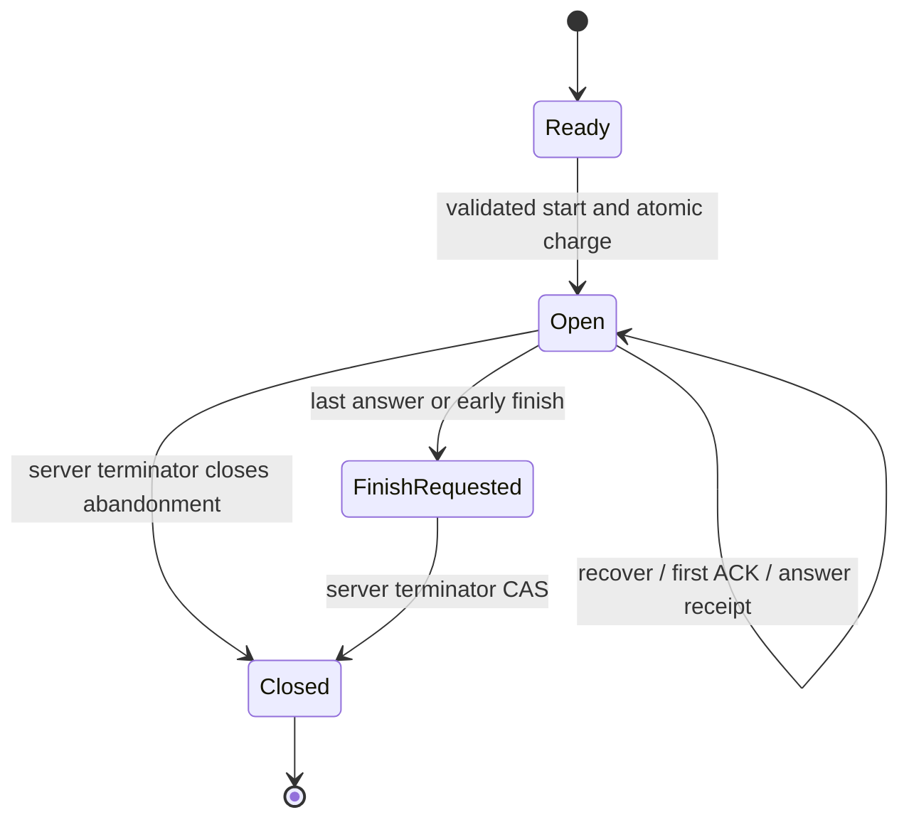

# Exam protocol

This companion specifies the assessment flow under the adopted exam AD-1–37 and initiative architecture. The theme test is the контрольная; the final exam is the separate course экзамен. Question-schema invariants remain intact; assessment timing, redaction and mixed composition follow this contract rather than an ordinary EASY/HARD ladder.

The adopted [assessment technical contracts](../../planning-artifacts/architecture/architecture-schoolquiz3.0-2026-08-29/assessment-technical-contracts.md) define C1 reward arithmetic, C2 correction arithmetic/economic preservation, C3 confirmed coverage and C4 execution/recovery; their linked fixtures are an implementation oracle, not evidence of a running implementation. Settled awards remain unchanged through correction; concrete activation prerequisites remain Q-EX-5.

Competition terminology follows [initiative AD-17](../../planning-artifacts/architecture/architecture-schoolquiz3.0-2026-09-29/ARCHITECTURE-SPINE.md): **турнир** is the first qualification part; **чемпионат** is the second final part, including its bracket and matches. Existing `tournament*`/`event` identifiers retain their technical meaning for the competition lifecycle; this naming update does not change assessment contracts.

## Owners and identity

Publication owns approved revisions, immutable manifests, the private draw index and current available counts. Learning owns confirmed lesson progress. Exam owns sittings, admission, terminal outcomes and certificate issue/sign/verify. Economy owns confirmed financial effects; profile reads the certificate projection. Shared scoring, answer, redaction and identity contracts do not merge ordinary, Arena, exam or tournament lifecycles.

Before dispatch, persist ownerUid, account epoch, operationId and immutable canonical request. Retries preserve that identity/body; conflicting reuse is rejected. Check the account scope before asynchronous work and after its response so A → B → A cannot apply an old response to a new session. Cancellation cannot undo a server commit.

At most one open sitting exists per user/assessment. Starting while one is open recovers it without another debit. Recovery returns the current permitted question and its original acknowledgement/deadline state, never a new attempt, a future question or restarted time. Immutable operation receipts prove the original effects; they do not make an old question snapshot current.

## Admission, draw and charge

| Contract | Theme test | Final exam |
| --- | --- | --- |
| Scope | All eligible questions below the theme | All eligible questions below the current course |
| Progress gate | Confirmed completion of all required EASY questions in every lesson | Every required non-archived theme id is passed |
| Draw | 5 EASY + 15 HARD, mixed | 20 HARD |
| Charge at new start | 100 STANDARD points (1 full charge) | 200 STANDARD points (2 full charges) |
| Pass mark | Server-configured, default 60% | Server-configured, default 60% |
| Cooldown key | theme:{themeId} | final:{courseId} |
| Cooldown | Rolling 24 hours from terminal closure | Rolling seven days (168 hours) from terminal closure; unlimited retakes |

Cooldown is per user/theme or user/course final, not a player-wide limit. Terminal closure starts the elapsed-time interval, including timeout and abandonment; there is no midnight, calendar-week or timezone reset. Recovering an already open sitting preserves that sitting and its original deadlines without another attempt or debit.

Draw uniformly from distinct approved available question identities; bind their exact revisions/private keys. No exposure weighting, adaptive selection, history exclusion, in-sitting easy gate or mandatory unscored item is added. Random sittings may coincidentally repeat a set.

A theme needs its 5-EASY/15-HARD drawable pool. A final also needs current course certification eligibility: at least 12 corresponding theme tests, each backed by at least 100 EASY and 100 HARD distinct approved available questions, plus the 20-HARD draw. Certification counts are publication-maintained sets, never increments on republication or historical quarantined counts. A smaller course may still publish, teach and offer theme tests when their draw gate passes.

Before a new start commits, the server checks authorization, confirmed progress, the latest approved course version, applicable bank eligibility, cooldown, shown terms and charge. Changed paid terms require renewed agreement; accepted config/bank/scoring revisions are frozen in the sitting. Start and debit commit atomically and idempotently. Entry uses only STANDARD points under spec-charges CAP-1; plasma never pays the toll, and no pool split is pending. Legacy final300 configuration is implementation drift to reconcile before enabling debit. Refusal or open-session recovery costs nothing extra.

Typed refusals are Locked, ResultsNotSynced, Cooldown, InsufficientCharge and PoolTooSmall, plus explicit unavailable server state. Unknown is not an expired cooldown, free price, confirmed zero or fabricated shorter draw. Flush relevant pending lesson results before requesting exam admission; server confirmation is still authoritative.

## Ordinary progression and purchases

Completing the required EASY work opens the ordinary HARD/next-lesson path locally, including offline, without waiting for HARD scoring. The exam requires confirmed coverage of every exact required canonical question/revision token under adopted C3, not rounded two-star display or a perfect arbitrary twenty-question subset. Union validated evidence across attempts and wait for the confirmed ingestion/materialization barrier; an upload acknowledgement alone is insufficient. Unknown manifest or legacy provenance remains unavailable/pending, while ordinary offline progression stays immediate.

Free course progression is sequential; nolics can open any locked lesson. The locked card retains its price and padlock; the exam lock distinguishes unavailable access from bought-but-unpassed work. Purchase gives no stars or pass and triggers no content download; provisioning is separate.

Preserve the accepted ordinary offline purchase: local unlock, provisional nolics debit and outbox enqueue commit in one Room transaction; retry uses the original operation, and terminal quarantine visibly rolls it back. The server owns the confirmed financial fact. This exception does not make exam starts offline or permit standalone local exam debits. Current economy tariffs replace old flat 10/20 prices; ordinary reward behavior remains unchanged, while assessments use the confirmed mode-specific new-progress coefficients below. Adopted C1 fixes mixed reward worth and independent currency rounding, separately from the all-HARD assessment answer timer.

Ordinary EASY may score locally. HARD keys stay server-side; ordinary offline HARD work has a pending result until confirmation, never an invented zero. Ready ordinary/Arena content gains no new mandatory network gate. Existing pause, recovery, Continue/Info/Back, localization and accessibility remain governed by the initiative contract.

## Screen-content confirmation

Separately confirm the content of every assessment screen against the overall product logic, including admission/start, the sitting, availability/cooldowns, results/advice, certificate lists/details and public verification. Approval of appearance alone does not approve all copy, displayed data, available actions or loading, pending, error and recovery states. Existing explicit product decisions remain constraints on that confirmation; screen drafting cannot silently revise admission, privacy, timing, financial or certificate rules.

## Lifecycle and time

The exam sweeper is the sole logical terminal writer, with compare-and-set/fencing. Foreground calls advance, request closure or read; they never independently terminate. The terminal transaction writes result, admission/cooldown projection and first-pass effects. Every successful final also commits its own immutable logical issuance fact and durable fulfilment work described below, including re-earning before expiry. A fetch before closure returns an explicit open state.

Prepare the image before question text. The first bounded acknowledgement that text rendered fixes the question deadline; duplicates return it. The first ACK gap starts at sitting creation and retains its existing bound without a newly chosen duration. For every subsequent question, the connection/download window uses the shared server-owned configuration from initiative AD-31, default60 seconds, frozen in the sitting rule snapshot rather than an independent exam constant. Its anchor is authoritative closure of the preceding question: acceptance of its timely answer or expiry of its original answer deadline; later config changes do not alter an open window. Reconnection, retry and delayed worker execution never restart that window. The window neither shortens nor extends an already acknowledged question's answer allowance.

Every ThemeTest and FinalExam question uses the ordinary HARD answer-time rule, including the five EASY theme positions: seconds=max(5,roundHalfUp(chars*0.24)), with the ordinary character-count convention and image equivalent100. Do not multiply by examFactor0.75. Difficulty labels, scoring and 5-EASY/15-HARD composition remain unchanged; capture the timer rule with the sitting. Client countdowns are display only. For100characters the allowance is24seconds; for10characters it is5seconds. The server computes and freezes each allowance. Expiry of the original question deadline automatically closes that question with the normal unanswered score (digit1) and opens the next-question window if questions remain. A timely accepted answer retains its commitment and server receipt time; recovery cannot replace it with a timeout. A timeout is not a paid correct skip or correct-answer progress and does not change rewards already earned from other scored answers. Expired delivery gaps, early finish and abandonment obtain a recorded terminal outcome; the unanswered remainder scores normally and consumes the assessment cooldown. Closing the final question requests normal terminalization without an extra 60-second wait. There is no pause that extends answer time. Tournament terminal ownership remains separate; its fixed global cutoff must be reconciled with the shared next-question window under initiative AD-31 before the affected adapter is enabled, without silently reducing the window or inventing a match/stage extension.

Adopted C4 defines the bounded exam-owned worker, trusted injected clock/store, sole terminal writer, leases/fencing and fair durable sweep progress. An isolated controlled driver invokes the same capability; production uses the existing Firebase Functions v2 onSchedule wake-up adapter without exposing worker controls to clients. Overlap, lost fences, crashes and poison work preserve the same receipts; scheduler delay never extends deadlines. Concrete environment, signing provider/algorithm, secret bindings, numerical budgets and operational recovery proof remain Q-EX-5 before activation. This contract starts no scheduler or service.

## Calls and answer commitment

All sitting calls authenticate and enforce ownership; public certificate verification is a separate unauthenticated read.

| Call | Bound input | Safe output |
| --- | --- | --- |
| startThemeTest | Operation identity, themeId, shown terms | Existing open sitting or new sitting projection |
| startFinalExam | Operation identity, courseId, shown terms | Existing open sitting or new final projection |
| acknowledgeQuestion | Sitting, current index/revision, operation identity | Original established deadline |
| submitAnswer | Sitting, index/revision, answer payload, operation identity | Durable receipt and safe current-state projection |
| finishSitting | Sitting and operation identity | Closure requested/open or already-closed state |
| fetchSittingResult | Sitting identity | Explicit open state or authoritative terminal result |

The first committed answer for sittingId/questionIndex wins. Bind owner, question revision and payload identity. Identical retry returns the same receipt; conflicting reuse cannot overwrite the answer or advance a different question. A timely durable receipt retains server arrival time across recoverable processing failure. Receipt UI has no correctness-dependent colour, mark or duration.

## Redaction, scoring and result

Use separate redacted wire/domain types; never make ordinary QuestionContent correctness fields nullable to fit an exam payload.

| Type | Required redaction |
| --- | --- |
| SingleChoice / MultipleChoice | Omit correct option identities |
| Ordering | Shuffle on the server; keep issued permutation and canonical identities private |
| FillBlank | Omit the correctness mapping |
| Survey | Exclude from assessment draws |

Wire answers use issued item identities and map to canonical identities exactly once. Preserve both the issued permutation and canonical answer as private evidence for scoring and correction. No response, UI/Room projection or general diagnostic exposes private keys, correct ordering, future questions, codeAnswer, score digits or per-item verdicts.

Both difficulties in the theme test and all final questions are scored on the server through the existing shared arithmetic. Kotlin/server golden cases stay consistent; assessment presentation has no scoring dependency. Percent determines passing against the captured threshold. The client renders returned percent, stars, pass state and advice without recalculation.

For a theme test, aggregate percent p in 0..100 maps linearly to 0..3 stars, using existing tenths precision and half-up rounding: starsTenths = floor((30*p + 50)/100). The server returns that value. Thus 0/50/100% gives 0/1.5/3 stars, and 15% gives 0.5. With a captured 60% pass threshold, 59% and 60% both display 1.8 stars but only 60% passes. This does not change ordinary lesson stars or decide optional final/course stars; those remain Q-EX-7.

The result projection contains sitting/assessment identity, result version, aggregate percent, passed state, server stars, safe advice, closed time and next-attempt availability. Use a fixed-length advice list even at perfect scores; do not identify lessons contributing fewer than the configured support threshold. Fall back to safe admission history when the sitting cannot support advice. The failed result routes back to lessons without revealing failed items.

## Progress, quality and corrections

There is one best mixed percent and passed projection per user/theme. Ordinary result updates are monotonic and commit with the terminal result. The final has distinct user/course result and cooldown projections; the overview reads permitted user-scoped records, not private session documents. The theme first-pass award boundary remains as specified under Assessment rewards; the linear star display does not change best-result selection.

A passed record carries by stable (courseId, themeId) after question edits. Final admission compares all required non-archived ids against the passed set; extra archived ids do not disqualify, while newly added required themes need a pass. A new start uses the latest approved course version, but active sittings keep frozen inputs. Genuine erroneous-result correction remains a separate exception to carry/monotonicity.

Every concrete revision becomes eligible after all required independent checks and approval, for both initial and later banks. Failed new revisions do not erase still-valid approved old revisions. Valid questions publish independently of failed siblings; submission validation does not enforce whole-course certification counts. Changed dependencies/translations require their own review, while unaffected evidence retains valid provenance.

Statistics and reports feed authorized review, including server-side periodic analysis, but are never automatic proof of error or an enforcement verdict. Confirmed erroneous revisions leave new draw pools and available counts while remaining in frozen active banks/audit. Author publication cannot voluntarily breach established certification eligibility; authorized quarantine may suspend new starts until the approved bank is repaired.

Persist sitting evidence separately from ordinary result events: owner/assessment identity, immutable selected revisions/keys, rules, issued ordering, canonical answers, server timings and original outcome. Adopted C2 recomputes from original slots plus cumulative authorized exclusions using the shared scorer’s nested truncation, captured pass mark and privacy rules. Append attributable versions and CAS the head; order/replay cannot compound prior rounded results. Recompute admission from usable latest outcomes, retaining another independently valid pass where present.

Publish the corrected head atomically with a consistent admission/best projection, or atomically mark a durable pending correction generation with that head. Materialization must CAS the same current generation; an older worker cannot overwrite newer proof. New final start atomically checks a complete matching admission generation before charge and refuses pending/mismatched proof. A crash after head publication therefore cannot expose the old pass as current authority; replay and another correction preserve the barrier. Completed recomputation may still use another independently valid pass. Already-started frozen sittings are not retroactively reopened or revoked.

C2 distinguishes UNSCORABLE_ALL_EXCLUDED from CORRECTION_PENDING_EVIDENCE. Both have numeric score/pass/stars absent; neither uses fabricated zero/100%, an invalid original result as current proof, or invented refund/free-retake/cooldown reset. Keep original history and any separate valid admission evidence.

Correcting a failed final into passing affects its versioned result, not certificate entitlement. Certificate creation requires a new successful final sitting; this leaves already-earned issuances untouched.

Confirmed-fault correction preserves every already settled nolics/XP award: no top-up, recoupment, repricing or second receipt. Original amounts and recorded accounted-progress history stay unchanged; correction neither advances nor resets the assessment maximum. A valid corrected first-ever theme pass may receive the existing one-time award only if no user/theme first-pass receipt exists, using the original frozen sitting basis and b=0. This is not a second award; preserve atomic receipt/admission and replay protection.

The shared theme aggregate generation covers every input-changing result write, including a newly terminal theme sitting while a correction is pending. All terminal/correction writers advance or transactionally coordinate that same generation. A materializer must validate the full input generation before publishing, so a stale correction result cannot overwrite a newer valid theme pass; retry recomputation against the new generation instead.

## Assessment rewards

Both nolics and XP use the existing weighted marginal tariff reward model and the exact frozen worth/currency arithmetic in adopted C1. Replace only the ordinary NEW-progress coefficient for the assessment mode; do not multiply the whole reward by an extra assessment factor.

| Mode | New-progress coefficient | Already-paid progress | Eligibility |
| --- | --- | --- | --- |
| Ordinary lesson | x2, unchanged | Existing x0.1, unchanged | Existing ordinary rules |
| Theme test | x3 | No repeat payout | First pass only |
| Final exam | x10 | x0.1 | Every terminal attempt, including failure and repeats |

Existing difficulty and allocated-time factors remain separate. For a HARD-only final, the HARD x3 factor produces effective NEW-progress 30 and REPEATED-progress 0.3 relative to the same pre-difficulty base. This is not a uniform x30 multiplier for the whole attempt; repeated progress never gains the final new-progress 10 coefficient.

C1 values each canonical approved available pool question at its ordinary EASY or HARD worth, independently of the all-HARD answer allowance. Publication selects one immutable worth-source revision per canonical question across translations. Freeze captured counts, capped 5/15 or 20-question pool means, time sums, manifest/hash and rule version with the sitting; ambiguity refuses before charge. Later content, actual elapsed time, answer countdowns and lucky draws cannot change this basis. Use the exact integer/rational calculation and independently round XP and nolics from the same unrounded amount; the linked fixtures cover bands, mixed weighting and rounding.

Measure new progress against the maximum result already accounted for in rewards for that user/assessment. An eligible confirmed reward calculation accounts for that progress even when currency rounding yields zero; a zero rounded payout does not reset the reference. Use the ordinary weighted marginal tariff calculation for the new and already-paid portions with the coefficients above, never raw percentage times coefficient. A later lower result does not lower that financial reference: after a rewarded 90%, later 70% and recovery to 90% are repeated progress; 95% contains new progress only above 90%. Commit the single payout result/receipt and updated maximum reward-accounted progress atomically, including a settled zero after rounding. Record the effect against the sitting, preserve the accounting history and reuse that receipt on retry. Retry/recovery of the same sitting is not another reward-bearing attempt.

This maximum accounted reward progress is distinct from the latest result and displayed certificate. A later passing 70% may become the displayed certificate after 90% without making the already-paid 70–90 interval new again. Certificate issuance still requires a successful final; reward eligibility does not.

Preserve the accepted theme first-pass-only award: one payout record per user/theme with awardedAt commits atomically with admission. Theme retakes and correction replay never pay again or remove an already recorded award; request retries preserve the same financial identity. An unpaid failed theme test does not advance the paid reference or reduce the later first-pass award. A theme test still issues no certificate.

Every terminal final attempt is eligible for nolics and XP, including failure; zero score does not promise a positive minimum. Coefficient placement, new/repeated-progress policy, maximum reward-accounted reference and C1 mixed/time/currency arithmetic are confirmed. Missing or invalid financial inputs remain explicit failure/pending, never a fallback zero. C2 correction leaves existing settled receipts, amounts and accounted-progress history unchanged: no top-up, recoupment or maximum update. A corrected first-ever theme pass follows the separate one-first-pass-receipt rule; future eligible sittings continue ordinary accounting from the unchanged maximum.

## Certificate issuance and verification

Only a successful terminal final authorizes a certificate. Re-earning is allowed before the prior certificate expires and after expiry under the same admission, current-bank, charge and cooldown rules. Each successful new final earns a distinct issuance tied to that sitting; a failed retake issues no certificate and does not replace the last earned certificate. Exam owns issuance/signing/verification; profile displays its read-only projection. Theme tests, section completion and generic client QuestCompleted/rewards events grant no issuance authority.

For every successful final, terminal success, its immutable logical issuance fact and durable signing/publication work commit atomically. Freeze issuanceId, earning resultVersion, sitting, percent, pass mark, bank/course snapshot, public/signed claims, issuedAt/expiresAt and key identity. A rollback commits neither success nor award. Sign outside the database transaction; never perform private-key/network I/O inside it. Pending signing/publication is explicit.

The profile/current-course certificate is the latest earned issuance, even when its passing percent is lower than an earlier one. Select by authoritative final earning/issuance order, not highest score or signing/publication completion time. Represent the newest issuance's pending fulfilment explicitly; late fulfilment of an older fact cannot replace a newer selection. CAP-7 best theme stars is unchanged.

Fulfilment retries use the same fact and never recheck a later corrected grade, create another identity or reset dates. A subsequent downward correction caused by our question error changes neither the issued identity, signed score/claims, dates, original expiry nor validity on that ground, even if signing is still pending. Preserve correction history separately; do not extend the year.

Retain every earlier attestation unchanged. Each remains independently verifiable with its original identity, claims, issue date, expiry and applicable status. Earning or displaying a later certificate neither rewrites nor revokes the earlier one. Signed-out verification reads the requested issuance's immutable permitted public snapshot and separate existing status policy, not mutable profile/course fields, a newly corrected score or whichever issuance is currently displayed.

Adopted C4 binds signing work to an expiring fence, exact frozen claims/key and issuance identity. Sign and verify outside the transaction; first verified artifact committed by fence/CAS wins, without assuming byte-deterministic signatures. Rotation exposes verification material before using a new key for new earnings; retain old verification material and signing capability while facts remain bound to it. Missing keys leave recoverable pending work and never rebind or publish unsigned. Provider/algorithm, concrete environment/secrets, numerical budgets/retention and demonstrated recovery remain Q-EX-5; no activation or new revocation ground is authorized.

The certificate attests an account's successful sitting, not a person's identity, proctoring or accreditation; it does not grant a gameplay qualification. Each issuance has its own fixed one-year validity from issue. Re-earning creates a new attestation from a new successful final and never extends or replaces the immutable facts of an earlier one.

A correction that changes a formerly failed final to passing does not authorize a new certificate for that sitting; only a new successful final sitting can earn one. Issuance already earned at original successful terminal closure, including pending signing, remains unchanged. Correction does not create a fresh earning order, bypass ordinary retake admission/charge/cooldown or restart the old sitting.

## Acceptance cases

1. Complete relevant EASY work, deliver its progress, start a theme test, lose the response and recover the same sitting with one charge and unchanged deadlines.
2. Submit a 5-EASY/15-HARD sitting without correctness leakage; retry ACK/answers, background/restart and abandon. Obtain exactly one terminal outcome, admission update, applicable first-pass effect and cooldown.
3. Pass all required themes; take the current-course 20-HARD final and earn the atomic logical certificate. Interrupt signing, correct the score downwards, retry fulfilment and verify the original attestation signed out without shifted dates.
4. Approve a revision without pretest; reject its next edit without losing the valid old revision. A complaint opens review only; confirmed quarantine excludes new draws and can block a new start before spending while active banks remain frozen.
5. Update questions in a passed theme, add a new required theme and archive an extra theme. Preserve the stable pass, require the new one, ignore the archived extra and draw the next final from the latest approved course.
6. Purchase a lesson offline, restart, deliver or quarantine the same operation. Preserve the provisional unlock/debit/outbox boundary and visible rollback; bought-but-unpassed content never opens exam admission.
7. Switch A → B → A, replay requests and race terminal work with recovery/correction. Preserve scoped projections, original evidence, one financial effect per start and one immutable issuance fact per successful final. Run these only in an authorized environment with current candidate evidence.
8. Earn 90%, then pass a later final at 70% before expiry: display the 70% certificate, preserve both immutable attestations and their own one-year dates, and verify each signed out. While the latest fulfilment is pending, finishing older signing cannot revert the selection. A later failed retake issues no certificate; retries create no extra issuance, move no dates and charge nothing extra.
9. Verify the linear theme-star endpoints and half-up tenths, including 15% → 0.5 stars. At a captured 60% pass mark, 59% → 1.8 stars fails while 60% → 1.8 stars passes; a normal worse retake preserves the best theme projection. Clients render the server value.
10. Verify both nolics and XP use ordinary new-progress 2, theme 3 and final 10 with final repeated-progress 0.1; preserve separate difficulty/time factors and existing weighted tariffs. A HARD final has effective new 30/repeated 0.3, not whole-attempt x30. Every terminal final is eligible including failure, without a zero-score minimum; theme pays only its first pass, and retries/correction do not duplicate financial effects. Run the adopted C1 mixed-basis and independent-rounding fixtures during later implementation parity checks.
11. Close a theme test and a course final, including timeout/abandonment cases. Refuse new starts until their respective closure plus 24 hours and closure plus seven days (168 hours); allow at the boundary when all other admission conditions hold. Crossing midnight or a week boundary does not reset availability, and recovering the same open sitting charges nothing extra.
12. Reward a final at 90%, then take 70%, 90% and 95% sittings. Keep the financial maximum at 90% through the lower/recovered attempts and pay new-progress 10 only above 90% on the 95% sitting, with repeated-progress 0.1 below it and separate difficulty/time factors. The latest passing certificate still follows earning order; retry the same sitting without a second reward.
13. Turn an originally failed final into a passing corrected result: retain the correction and current certificate, create no new issuance, and require a new successful final for a certificate. Replay creates no issuance; a pending issuance from an originally successful final still completes.
14. Serve100-character EASY and HARD questions in a theme and HARD questions in a final: all receive24seconds under the ordinary HARD rule. Verify the5-second floor, half-up rounding and unchanged firstACK deadlines/retries. The assessment adapter must not apply the inherited0.75 factor or turn the five EASY questions into HARD.
15. Exercise C2 cumulative exclusions in both orders, unanswered denominator and nested truncation; distinguish all-excluded from missing evidence without numeric scores or invented compensation. Preserve another valid theme pass, no retrospective certificate and already-earned pending issuance. First corrected theme pass awards once only if no receipt exists; keep already-settled amounts, receipts and accounted-progress history unchanged through both upward and downward correction.
16. Confirm a required set larger than twenty across multiple ordinary attempts using C3 tokens/manifests; reject forged digits, wrong revisions, duplicate language, wrong owner and ambiguous legacy proof. Preserve offline local progression while new exam start waits for current confirmed materialization.
17. In a separately authorized environment, prove C4 overlap/crash/fence/backlog/poison-record and rotation scenarios, including an old pending issuance and delayed older publication. Preserve receipts, frozen times and latest-earned certificate selection; record concrete Q-EX-5 operational evidence before activation.
18. Pause correction after publishing its head with pending admission generation, then attempt a new final: refuse before charge. Race projection completion, retry, another correction and a stale materializer; only the complete current generation may authorize start, and another independently valid pass remains usable after recomputation.
19. Publish a pending correction, then commit a new valid theme sitting before the correction projection job finishes. Require the shared full aggregate generation to reject the stale materializer, preserve the new pass and recompute from current inputs; new-final admission still obeys the readiness barrier.
